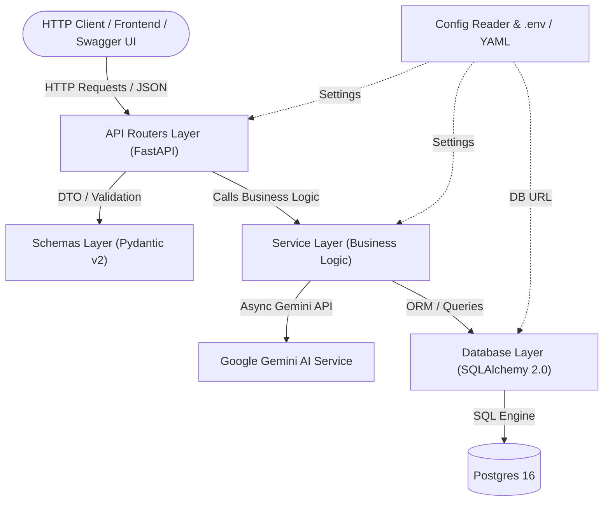
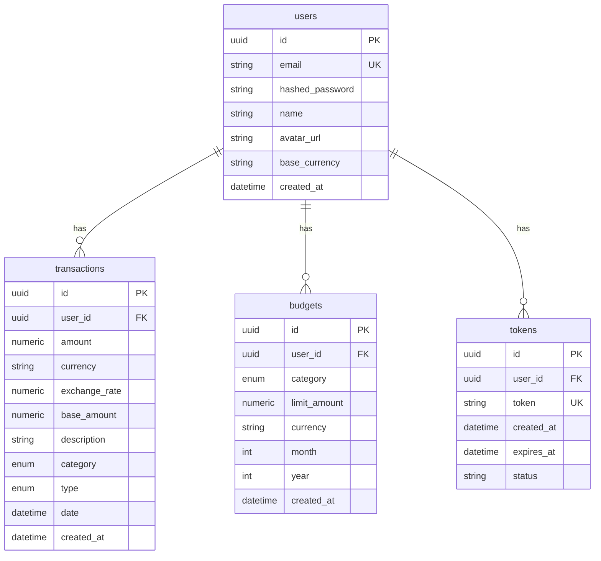

# Архитектура и база знаний проекта GetBalance AI API

> [!NOTE]
> Данный документ является единым источником правды по архитектуре, модели данных, контрактам и правилам работы с проектом **GetBalance AI API**.

---

## 1. Назначение и стек технологий

**GetBalance AI API** — бэкенд-сервис (REST API) для персонального учета финансов с интеграцией искусственного интеллекта (Google Gemini) и возможностью пакетной офлайн-синхронизации.

* **Репозиторий**: `jbronxxx/getbalanceai_api`
* **Фреймворк**: FastAPI (Python 3.11+)
* **База данных и ORM**: PostgreSQL 16, SQLAlchemy 2.0 (Async Session, asyncpg)
* **Миграции**: Alembic
* **Валидация и DTO**: Pydantic v2 (`ConfigDict`, `Field`)
* **Аутентификация**: JWT (`python-jose`), хеширование паролей (`bcrypt`), ротация Refresh-токенов
* **Интеграция с LLM**: Google Gemini API
* **Кэширование**: Redis 7 (кэширование инсайтов и аналитических рекомендаций с отказоустойчивым graceful fallback)
* **Конфигурация**: Pydantic Settings + `.env`
* **Контейнеризация**: Docker & Docker Compose
* **Тестирование**: Pytest (`TestClient`, `httpx.AsyncClient`)

---

## 2. Архитектурный стиль и слои (Layered Architecture)

Проект спроектирован по принципам многослойной архитектуры с четким разделением ответственности (Separation of Concerns):



### Зоны ответственности слоев:
1. **API Routers (`app/routers/`)**: Прием и диспетчеризация HTTP-запросов, проверка прав доступа, сериализация ответов в единые форматы `ApiResponse[T]` и `ErrorResponse`. Сложной бизнес-логики не содержат.
2. **Service Layer (`app/services/`)**: Вся предметная логика, расчеты бюджетов, криптография, ротация токенов, интеграция с внешними LLM API и кэширование аналитики.
3. **Schemas (`app/schemas/`)**: Pydantic-схемы валидации входящих данных (Request DTO) и структуры ответов (Response DTO).
4. **Data Layer (`app/models/`, `app/database.py`)**: Определение схемы реляционных таблиц через декларативные модели SQLAlchemy 2.0 и управление жизненным циклом сессий `async_session_maker`.

---

## 3. Схема базы данных



### Таблицы:
* `users`: Пользователи системы (email, хешированный пароль, имя, аватар `avatar_url`, базовая расчетная валюта `base_currency`)
* `tokens`: JWT access и refresh токены сессий пользователей с отслеживанием статуса (`active`, `revoked`, `expired`)
* `transactions`: Финансовые операции (доход/расход с категорией, датой и мультивалютными полями стандарта `NUMERIC(18, 2)` и `NUMERIC(18, 6)`: `amount`, `currency`, `exchange_rate`, `base_amount`)
* `budgets`: Лимиты расходов по категориям (по месяцам и годам, поле `limit_amount` типа `NUMERIC(18, 2)` в валюте лимита `currency`, CHECK `ck_budgets_currency`)
* `alembic_version`: Служебная таблица для отслеживания миграций

### Перечисления и типы (Category, TransactionType, CurrencyCode):
* **Коды валют (`CurrencyCode`)**: централизованное перечисление поддерживаемых валют системы (`USD`, `EUR`, `KZT`, `UZS`), используемое в моделях, Pydantic-схемах и сервисе котировок.
Категории разделены на два множества для обеспечения валидности финансовых данных:
* **Категории доходов (`INCOME_CATEGORIES`)**: `salary` (зарплата), `freelance` (фриланс/подработка), `investments` (инвестиции/вклады), `transfers` (переводы и подарки), `cashback` (кэшбэк и бонусы), `sales` (продажи), `other` (прочее).
* **Категории расходов (`EXPENSE_CATEGORIES`)**: `food` (продукты и питание), `transport` (транспорт), `entertainment` (развлечения), `health` (здоровье и медицина), `subscriptions` (подписки и сервисы), `shopping` (покупки и одежда), `other` (прочее).

**Мультивалютность и правила конвертации:**
1. **Модель хранения курсов (исторический settled rate против текущего live rate)**:
   - Поле `amount` хранит сумму в оригинальной валюте транзакции (`currency`). Допустимые коды валют строго ограничены справочником `CurrencyCode` и защищены ограничениями целостности на уровне БД (`ck_users_base_currency`, `ck_transactions_currency`).
   - Поля `exchange_rate` и `base_amount` в таблице `transactions` фиксируют финансовое состояние на момент совершения операции (исторический курс). Рыночные колебания курсов валют не меняют зафиксированные суммы прошлых транзакций, предотвращая искажение финансовой отчетности.
   - Текущие рыночные котировки (`CurrencyService`) используются исключительно для создания новых операций, сверки клиентского ввода и единовременного пересчета при осознанной смене базовой валюты профиля.
2. Единая точка согласования курсов и сумм — `CurrencyService.resolve_amounts(...)`. При совпадении валюты операции с базовой курс строго равен 1.0, а `base_amount = amount`. Для мультивалютных операций курс сверяется с серверным кросс-курсом котировок (допустимое отклонение задается `CLIENT_RATE_TOLERANCE_PERCENT`, по умолчанию 15%), а базовая сумма всегда вычисляется сервером по формуле `(amount * exchange_rate).quantize(0.01)`.
3. У каждого лимита своя валюта (`budgets.currency`, по умолчанию — базовая валюта пользователя на момент создания); `spent` и `remaining` возвращаются в ней. Расходы агрегируются одним SQL-запросом `SUM(amount)`/`SUM(base_amount)` с группировкой по категории, периоду и валюте операции, затем переводятся в валюту лимита: операции в той же валюте — по сумме чека, лимит в базовой валюте — по `base_amount` (исторический курс), остальные — по текущему кросс-курсу `CurrencyService.calculate_cross_rate`. Для ускорения фильтрации и использования планировщиком БД составного индекса `ix_transactions_user_id_type_date` применяются строгие диапазонные условия (`date >= start_date AND date < end_date`). `CurrencyService.get_rates()` вызывается только если у лимита не в базовой валюте есть траты в другой валюте; лимиты в базовой валюте читаются без обращения к котировкам. ETag курсы не учитывает: `spent` таких лимитов обновляется при следующей мутации данных (клиент считает траты локально).
4. **Централизованный модуль Redis (`app/redis.py`) и схема ключей**:
   - Единый пул соединений и синглтон-клиент (`get_redis()`) с корректным освобождением ресурсов (`close_redis()`) в `lifespan` FastAPI (рядом с `engine.dispose()`).
   - Устранение перекрестных импортов: сервисы импортируют функции управления кэшем из `app.redis`, исключая скрытые зависимости (например, `budget_service` от `ai_service`).
   - Централизованные билдеры ключей:
     - `REDIS_KEY_CURRENCY_RATES = "currency_rates:USD"` — основной кэш котировок (TTL из конфигурации).
     - `REDIS_KEY_CURRENCY_RATES_LAST_SUCCESSFUL = "currency_rates:last_successful:USD"` — постоянный источник резервных котировок без TTL.
     - `get_budgets_version_key(user_id)` -> `budgets_version:{user_id}` — версия ETag для бюджетов.
     - `get_insights_cache_key(user_id, locale, currency, month, year)` -> `insights_cache:{user_id}:{locale}:{currency}:{month}:{year}` — сохранённый AI-отчёт за месяц вместе с отпечатком данных периода (TTL 400 дней).
     - `get_insights_daily_quota_key(user_id, date_str)` -> `insights_daily_calls:{user_id}:{date_str}` — суточный счётчик вызовов LLM.
     - `get_insights_user_patterns(user_id)` — маски для неблокирующей инвалидации через `scan_iter` (включая счётчики `insights_tx_count:*` прежней схемы до истечения их TTL).
5. Справочник котировок обслуживается сервисом `CurrencyService` с многоуровневым кэшированием в Redis (основной кэш, постоянный ключ успешных котировок, и негативный кэш с TTL 180 с при падении внешнего шлюза для предотвращения блокировок очереди запросов, пул соединений через переиспользуемый `httpx.AsyncClient`). При сбое шлюза и отсутствии кэша возвращается базовая таблица с фиксированной датой ее актуализации (`FALLBACK_RATES_UPDATED_AT`), исключая фиктивные отметки «свежести». При пакетной синхронизации котировки запрашиваются лениво — только при наличии мультивалютных транзакций.
6. **Политика и механика пересчета финансов при смене базовой валюты**:
   - При обновлении `base_currency` через `PATCH /api/v1/auth/me` (защищенном rate limiter 10/мин) сервис атомарно пересчитывает курсы и `base_amount` всех транзакций единым пакетным SQL `UPDATE ... values(exchange_rate=case(...), base_amount=case(...))` без загрузки объектов в память Python.
   - Для транзакций в новой базовой валюте курс фиксируется строго в 1.0, а `base_amount = amount`.
   - Полная математическая обратимость: цикл смены валюты (например, EUR -> USD -> EUR) полностью возвращает исходные значения без накопления погрешности IEEE-754.
   - Лимиты бюджетов не пересчитываются: у каждого своя валюта (`budgets.currency`).
   - Заголовок `ETag` бюджетов пользователя инвалидируется в Redis, а кэш AI-инсайтов пользователя очищается через неблокирующий `scan_iter` и `unlink` (исключая O(N) `KEYS` и опасный `FLUSHDB`).
7. **Отказоустойчивость, оптимизация синхронизации и предотвращение race conditions**:
   - В `BudgetService.create` создание/обновление лимита выполняется через атомарный `insert().on_conflict_do_update(...)` (совместимый с PostgreSQL и SQLite), предотвращая ошибки параллельного создания лимитов по одной категории.
   - Ограничение объема запроса: не более 500 элементов на списки транзакций и бюджетов в `POST /api/v1/sync`.
   - Устранение проблемы N+1: пакетное удаление бюджетов объединено в единый SQL-запрос (`or_`, `tuple_().in_()`), выборка существующих бюджетов ограничена ключами пакета, а коммит с `expire_on_commit=False` исключает цикл запросов `refresh()`.
   - Изоляция конфликтов ID: чужие или конфликтующие идентификаторы транзакций и бюджетов не вызывают ошибку целостности (500) и не роняют весь батч, а безопасно возвращаются клиенту в списке `rejected` с причиной для удаления из очереди повторов.
   - Идемпотентный UPSERT бюджетов по ID или составному ключу `(category, month, year)` с дедупликацией элементов.
   - Любые мутации бюджетов или транзакций (создание, удаление, синхронизация) автоматически инвалидируют ETag бюджетов пользователя (`BudgetService.invalidate_etag`).

**Правила валидации:**
1. При создании или синхронизации транзакций категория строго сопоставляется с типом операции: доходы не могут быть отнесены к сугубо расходным статьям, а расходы — к доходным источникам.
2. Бюджеты (`budgets`) могут устанавливаться исключительно для расходных категорий (`EXPENSE_CATEGORIES`).

---

## 4. Структура каталогов

```
getbalanceai_api/
├── app/                        # Основной пакет приложения
│   ├── legal/                  # Тексты публичных страниц (ru/en/uz/kk): privacy.py, terms.py, delete_account.py, ui.py
│   ├── models/                 # ORM-модели SQLAlchemy 2.0
│   │   └── models.py           # Модели User, Token, Transaction, Budget и Enum-типы
│   ├── routers/                # Эндпоинты FastAPI (Контроллеры)
│   │   ├── auth.py             # Авторизация (/register, /login, /refresh, /logout, /me)
│   │   ├── budgets.py          # CRUD бюджетов и расчет ETag
│   │   ├── currencies.py       # Котировки валют (/api/v1/currencies/rates)
│   │   ├── insights.py         # AI-аналитика расходов (/api/v1/insights)
│   │   ├── public.py           # Публичные HTML-страницы (/privacy, /terms, /delete-account)
│   │   ├── sync.py             # Пакетная офлайн-синхронизация
│   │   └── transactions.py     # CRUD транзакций и расчет ETag
│   ├── schemas/                # Pydantic v2 DTO
│   │   └── schemas.py          # ApiResponse[T], ErrorResponse, схемы сущностей
│   ├── services/               # Слой бизнес-логики
│   │   ├── ai_service.py       # Интеграция с Google Gemini и кэширование инсайтов
│   │   ├── insights_formatting.py # Названия категорий и формат сумм для AI-отчёта, как в приложении
│   │   ├── auth_service.py     # Пароли, JWT, ротация и очистка токенов
│   │   ├── budget_service.py   # Лимиты бюджетов и подсчет расходов
│   │   ├── currency_service.py # Получение и кэширование котировок валют (Redis, fallback)
│   │   ├── legal_pages.py      # Выбор языка и HTML-рендеринг публичных страниц
│   │   └── transaction_service.py # Операции с транзакциями и генерация ETag
│   ├── tasks/                  # Фоновые и регламентные процессы
│   │   └── token_cleanup.py    # Регламентная очистка устаревших токенов
│   ├── database.py             # Подключение к PostgreSQL, SessionLocal, UnitOfWork и get_db
│   ├── exceptions.py           # Доменные исключения (AppException) и коды ошибок ErrorCode
│   ├── limiter.py              # Инициализация Rate Limiter (SlowAPI)
│   └── redis.py                # Централизованный клиент Redis и генераторы ключей
├── config_reader/              # Загрузка и объединение YAML + .env
│   └── config_reader.py
├── logger/                     # Структурированное логирование
│   └── logger.py
├── migrations/                 # Alembic миграции
│   ├── versions/
│   ├── env.py
│   └── script.py.mako
├── scripts/                    # CLI-скрипты и утилиты
│   ├── cleanup_tokens.py       # Запуск регламентной очистки токенов через cron/CLI
│   └── delete_user_by_email.py # Административное удаление аккаунта по email (запросы без входа в приложение)
├── tests/                      # Набор тестов Pytest
│   ├── conftest.py             # Фикстуры тестов
│   ├── test_ai_service.py      # Модульные тесты AIService
│   ├── test_insights_formatting.py # Формат категорий и сумм в данных для LLM
│   ├── test_auth.py            # Интеграционные тесты профиля пользователя и базовой валюты
│   ├── test_auth_service.py    # Модульные и интеграционные тесты аутентификации
│   ├── test_delete_user_by_email.py # Тесты CLI-скрипта удаления пользователя по email
│   ├── test_budget_service.py  # Модульные тесты сервиса бюджетов
│   ├── test_budgets.py         # Интеграционные тесты эндпоинтов бюджетов
│   ├── test_errors.py          # Тесты контрактов ошибок
│   ├── test_fintech_integrity.py # Тесты точности Decimal и индексов БД
│   ├── test_income_categories.py # Тесты категорий доходов и валидации типов
│   ├── test_multi_currency.py  # Тесты мультивалютности
│   ├── test_observability.py   # Тесты healthcheck и сквозного Correlation ID
│   ├── test_public_pages.py    # Тесты публичных страниц (/privacy, /terms, /delete-account)
│   ├── test_redis_module.py    # Модульные тесты централизованного клиента и ключей Redis
│   ├── test_oauth_verification.py # Проверка ID-токенов Google/Apple на реальной RSA-подписи (aud, iss, email_verified)
│   ├── test_security.py        # Тесты CORS, Rate Limiting, ключа лимитера, сложности паролей и prod-настроек
│   ├── test_sync.py            # Интеграционные тесты офлайн-синхронизации
│   ├── test_transaction_service.py # Тесты сервиса транзакций
│   ├── test_transactions.py    # Тесты транзакций и кэширования инсайтов
│   └── test_unit_of_work_and_cleanup.py # Тесты Unit of Work и регламентной очистки токенов
├── .env.example
├── .gitignore
├── alembic.ini
├── app_config.yaml
├── Dockerfile
├── docker-compose.yml
├── main.py                     # Точка входа, lifespan, обработчики ошибок
├── README.md
├── requirements.txt            # Зависимости приложения
├── requirements-dev.txt        # Зависимости для тестирования и разработки
├── RESPONSE_FORMAT.md          # Спецификация форматов ответов API
├── ARCHITECTURE.md             # Архитектурная документация сервиса
└── TEST_CHECKLIST.md           # Чек-лист проверок (автотесты и QA)
```

---

## 5. Стандарты контрактов API и соглашения

1. **Единый формат ответов**:
   * **Успешный ответ**: `ApiResponse[T]`
     ```json
     {
       "status": "success",
       "data": {},
       "message": null
     }
     ```
   * **Ответ с ошибкой**: `ErrorResponse` (со строгим машиночитаемым `ErrorCode` в формате `SCREAMING_SNAKE_CASE`):
     ```json
     {
       "status": "error",
       "code": "BUDGET_LIMIT_EXCEEDED",
       "message": "Превышен лимит бюджета для данной категории",
       "details": {}
     }
     ```
   * **Простой ответ**: `BaseResponse` (для операций `delete` / `logout`).
   * Полная спецификация и примеры приведены в [`RESPONSE_FORMAT.md`](RESPONSE_FORMAT.md).

2. **Исключения**:
   * В контроллерах и сервисах выбрасываются доменные исключения `AppException` (`BadRequestException`, `NotFoundException`, `UnauthorizedException`) из `app.exceptions`, которые автоматически конвертируются в `ErrorResponse` глобальным обработчиком в `main.py`.

3. **Аутентификация и сессии**:
   * Используется схема с двумя токенами: короткоживущий `access_token` (JWT) + долгоживущий `refresh_token` (JWT).
   * **Stateless JWT**: `access_token` не сохраняется в базу данных и валидируется криптографически без обращения к СУБД.
   * **Сессия**: access и refresh токены выдаются парой (`AuthService._issue_token_pair`) при входе и ротации; `id` строки refresh-токена в `tokens` записывается в access-токен как claim `sid`.
   * **Logout** (`POST /auth/logout`, `DELETE /auth/me`) завершает только текущую сессию: refresh-токен с `id = sid` помечается `revoked`, а `jti` access-токена записывается в Redis (`revoked_jti:{jti}`) с TTL до истечения токена. `get_current_user` проверяет этот ключ, поэтому отзыв сразу действует во всех воркерах gunicorn; другие устройства пользователя не затрагиваются. Выход завершается только после подтверждённой записи в Redis: при его недоступности ответ `503 SERVICE_UNAVAILABLE`, транзакция откатывается вместе с отзывом refresh-токена, токены остаются действующими, а `DELETE /auth/me` не удаляет аккаунт. У access-токенов, выданных до появления `sid`, при logout отзывается только сам access-токен; после ближайшей ротации пара уже связана.
   * Реализован паттерн **Refresh Token Rotation**: при обновлении токена старый refresh-токен помечается в БД как `revoked`, а клиенту выдается новая пара токенов.
   * **OAuth и синхронизация профиля**:
     * При входе через Google (`POST /api/v1/auth/google`) и Apple (`POST /api/v1/auth/apple`) проверяются подпись (JWKS провайдера; ключи кэшируются на час в клиенте уровня класса `AuthService`, то есть один раз на воркер, а не на запрос), срок, `aud` и `iss` ID-токена (`AuthService._decode_oauth_token`). `aud` должен совпасть с одним из client ID из `GOOGLE_CLIENT_ID` / `APPLE_CLIENT_ID` (список через запятую — Android, iOS, Web); без настроенных client ID вход через провайдера отклоняется. `iss`: Google — `accounts.google.com` или `https://accounts.google.com`, Apple — `https://appleid.apple.com`. Для Google дополнительно требуется `email_verified=true`.
     * Эндпоинт Google поддерживает опциональные поля `avatar_url` и `name` в теле запроса в качестве fallback при кешировании ID-токена Google Play Services / GIS на мобильном клиенте.
     * При наличии нового аватара `user.avatar_url` автоматически обновляется в БД. Если имя пользователя оставалось дефолтным (префикс email), оно актуализируется на реальное имя из Google.
     * `TokenResponse` возвращает профиль `user` (`UserResponse`), что позволяет клиенту мгновенно получить актуальное состояние аккаунта без дополнительного запроса к `/me`.

4. **Безопасность и ограничение частоты запросов (Security & Rate Limiting)**:
   * **CORS Middleware**: Подключен `CORSMiddleware` с параметризацией разрешенных ориджинов, методов и заголовков через `app_config.yaml` и переменные окружения (`CORS_ORIGINS`, `CORS_ALLOW_METHODS`, `CORS_ALLOW_HEADERS`). `CORS_ALLOW_CREDENTIALS` по умолчанию `false`: клиенты авторизуются Bearer-токеном, cookie не используются.
   * **Rate Limiting**: Используется `slowapi` для защиты критичных эндпоинтов авторизации (`/register`, `/login` — 5 запросов/мин) и ресурсоемких AI-инсайтов (`/insights` — 10 запросов/мин). При превышении возвращается стандартизированный `ErrorResponse` с HTTP 429 и кодом `RATE_LIMIT_EXCEEDED`.
     * Ключ лимита — `user:<sub>` только из access-токена с проверенной подписью и сроком (`app/limiter.py`), иначе IP клиента: поддельный `sub` не даёт отдельного счётчика.
     * IP клиента за nginx: nginx перезаписывает `X-Forwarded-For` значением `$remote_addr`, gunicorn запущен с `--forwarded-allow-ips "*"` (gunicorn 23 не принимает подсеть CIDR; порт 8000 доступен только из сети Docker и с хоста).
     * Счётчики хранятся в `RATE_LIMIT_STORAGE_URI` (в docker-compose — Redis, общий для 4 воркеров gunicorn; по умолчанию `memory://`, например в тестах). При недоступности Redis лимиты временно считаются в памяти воркера (`in_memory_fallback_enabled`), запросы не падают.
   * **Валидация сложности паролей**: Пароли при регистрации ограничены 72 байтами (жесткий лимит алгоритма bcrypt) и валидируются на наличие хотя бы одной буквы и одной цифры.
   * **Защита продакшн-конфигурации**: `APP_DEBUG` по умолчанию `false`. При старте в режиме `debug=False` блокируется запуск с дефолтным или пустым `SECRET_KEY`, без `GOOGLE_CLIENT_ID` (`APPLE_CLIENT_ID` необязателен — без него вход через Apple отклоняется) и с `CORS_ORIGINS=*` вместе с `CORS_ALLOW_CREDENTIALS=true`.

5. **Управление транзакциями и пулом соединений (Unit of Work, get_db & Pool Resilience)**:
   * **Чистый слой сервисов**: Сервисы (`TransactionService`, `BudgetService`, `AuthService`) не управляют состоянием транзакции напрямую (`commit`/`rollback`), а только оперируют объектами (`db.add()`, `db.delete()`, `db.flush()`).
   * **Автоматическое управление транзакциями**: Зависимость `get_db` в FastAPI автоматически выполняет `commit()` при успешной обработке запроса и `rollback()` при возникновении исключения.
   * **Контекстный менеджер UnitOfWork**: Предоставляет контекстный менеджер `with UnitOfWork() as session:` для атомарных составных операций вне HTTP-запросов (в фоновых задачах, CLI-скриптах и тестах).
   * **Отказоустойчивость пула соединений (Pool Resilience)**: В `create_async_engine` включен `pool_pre_ping=True` (пессимистическая проверка доступности соединений перед выдачей из пула для защиты от `InterfaceError: connection is closed` при перезапуске БД или сбросе idle-соединений), а также `pool_recycle=1800` для упреждающей ротации TCP-сессий и корректное освобождение ресурсов `engine.dispose()` в `lifespan`.

6. **Фоновые и регламентные процессы (Token Cleanup)**:
   * **Периодическая очистка токенов**: Корутина `periodic_token_cleanup` (`app/tasks/token_cleanup.py`) запускается в `lifespan` каждого воркера gunicorn и удаляет истекшие или отозванные токены старше 30 дней (`expires_at < now() - interval '30 days'`).
   * **Один запуск на кластер**: раз в час каждый воркер пытается занять блокировку `lock:token_cleanup` в Redis (`SET NX EX 86400`). Очистку выполняет только воркер, занявший её, — не чаще раза в сутки; остальные пропускают проверку (DEBUG). Сутки отсчитывает TTL блокировки, а не таймер процесса, поэтому рестарты при деплое не откладывают очистку. При сбое очистки блокировка снимается, и ближайшая проверка любого воркера повторяет её; при недоступном Redis проверка пропускается (WARNING), а не выполняется всеми воркерами.
   * **Автономный CLI-скрипт**: Для запуска регламентной очистки через системный планировщик (cron, Kubernetes CronJob) реализован скрипт `scripts/cleanup_tokens.py` с поддержкой параметра `--days`.
7. **Публичные юридические страницы (Google Play / App Store)**:
   * `GET /privacy`, `GET /terms`, `GET /delete-account` (`app/routers/public.py`, без авторизации, вне `/api/v1`, не входят в OpenAPI) возвращают адаптивный `HTMLResponse` в цветах бренда `#0D9488` (светлая и тёмная тема).
   * Язык — `?lang=ru|en|uz|kk`, иначе по `Accept-Language`, иначе `en` (`resolve_language`). Неподдерживаемое значение `lang` игнорируется и в разметку не попадает. Ответ кэшируется (`Cache-Control: public, max-age=3600`, `Vary: Accept-Language`).
   * Тексты хранятся в пакете `app/legal/` (данные), рендеринг и выбор языка — `app/services/legal_pages.py`; весь пользовательский контент экранируется через `html.escape`. Контактный email — `SUPPORT_EMAIL` в `app/legal/ui.py`.
   * Страница удаления описывает удаление в приложении (*Профиль → Удалить аккаунт*), перечень безвозвратно удаляемых данных и удаление по email без входа в приложение (срок — 30 дней). URL указываются в Play Console (Data Safety, Privacy Policy) и открываются из мобильного приложения.
   * Nginx проксирует пути на API, кроме закрытого `/metrics` и `/docs`, `/redoc`, `/openapi.json` за basic auth (см. раздел 7). Для `/privacy`, `/terms`, `/delete-account` в `nginx/conf.d/default.conf` действует лимит `5r/s` на IP (`limit_req_zone` по ключу из `map $uri`, `burst=20 nodelay`, при превышении — `429`); остальные пути лимитом Nginx не затрагиваются.
   * Сроки хранения, указанные в текстах, должны совпадать с настройками: резервные копии БД — 7 последних файлов `scripts/backup_db.sh` при ежедневном cron (≈7 суток) и не более 3 копий перед деплоем (`predeploy`, не дольше 7 суток); зашифрованные копии в Cloudflare R2 удаляются lifecycle-правилом бакета через 7 дней, логи Loki — 30 дней. При изменении настроек обновляйте `app/legal/`.
   * Запросы на удаление по email выполняются администратором скриптом `scripts/delete_user_by_email.py`: он вызывает `AuthService.delete_account` (те же шаги, что у `DELETE /auth/me`: каскадное удаление в БД и очистка ключей Redis).


---


## 6. Специфика AI Service (`app/services/ai_service.py`)

Сервис `AIService` формирует персонализированные финансовые рекомендации на основе транзакций и соблюдения лимитов бюджетов пользователя:
* **Асинхронность и неблокирующие вызовы**: Использует официальный SDK `google-genai` с асинхронным вызовом `await self.client.aio.models.generate_content(...)` на базе легковесной модели `gemini-3.5-flash-lite`. Поддерживает внедрение зависимостей (`Dependency Injection`) при инициализации в тестах.
* **Нативный Structured Outputs и надежный fallback**: Запросы отправляются с конфигурацией `types.GenerateContentConfig(response_mime_type="application/json", system_instruction=...)`. Вспомогательный метод `_extract_json()` гарантирует надежное извлечение валидного JSON-объекта даже при наличии markdown-оберток или поясняющего текста модели.
* **Учет бюджетов и защита от Prompt Injection**: В системную сводку `_build_summary` включаются два блока: 1) Сводка по лимитам категорий на месяц (`категория | лимит | потрачено | остаток | статус превышения`, суммы — в валюте лимита); 2) Список транзакций. Категории и суммы записываются так же, как в приложении на языке отчёта (`app/services/insights_formatting.py`: названия из локализаций приложения, «154 771 сум», «1 000 ₸», «$12,50»), а системная инструкция требует повторять их дословно: без синонимов категорий («Еда» вместо «Питание»), без банковских кодов валют и без пересчёта сумм. Описания транзакций `description` предварительно очищаются от управляющих символов, переводов строк (`\n`, `\r`) и символа пайпа (`|`).
* **Хранение отчётов и экономия вызовов LLM (Redis)**:
  - Отчёт за месяц хранится в `insights_cache:{user_id}:{locale}:{currency}:{month}:{year}` 400 дней (Redis с AOF) вместе с **отпечатком данных месяца** (`_month_fingerprint`: число и суммы `amount`/`base_amount` операций периода по категории, типу и валюте + категория, валюта и сумма каждого лимита) и числом операций.
  - Сохранённый отчёт актуален только при точном совпадении отпечатка: любое изменение операций или лимитов месяца (добавление, удаление, правка суммы, категории, валюты) — новая генерация при `generate=true`, чтобы суммы в тексте совпадали с экраном «Бюджет».
  - **Без вызова LLM** (`InsightResponse.state`): будущий месяц и месяц без операций — `no_data` (операции других месяцев в сводку не подмешиваются); `generate=false` — сохранённый отчёт или `not_generated`; если данные изменились после генерации, отчёт отдаётся с `is_outdated=true`.
  - Суточная квота (`insights_daily_calls:{user_id}:{date_str}`, `ai_daily_limit_per_user`): при исчерпании отдаётся сохранённый отчёт **этого же** периода (если данные изменились — `state=quota_exceeded`, `is_outdated=true`) или локализованное сообщение (`state=quota_exceeded`); отчёт другого месяца не подставляется.
  - Ошибка LLM (невалидный ключ, 503 провайдера и т. п.) не попадает в кэш и квоту: ответ `state=busy` с локализованным «помощники заняты».
* **Интернационализация (i18n)**: Полная поддержка локалей `ru`, `uz`, `en`, `kk` (казахский язык) во всех заглушках, сервисных и фолбэк-сообщениях.
* **Временные метки в UTC**: Все генерируемые ответы содержат timezone-aware временные метки `datetime.now(timezone.utc)`.
* **Заглушки при отсутствии ключа**: При пустом или тестовом ключе `GEMINI_API_KEY` (например, `sk-...`, `your-...`) возвращается информационная заглушка `InsightResponse(insights=["В разработке..."])`.

---

## 7. Обсервабилити и Мониторинг (Observability)

Проект включает в себя полноценный стек для мониторинга и логирования, разворачиваемый вместе с основными сервисами:

* **Логирование (Loki + Promtail)**:
  * Сервис `promtail` собирает логи всех запущенных Docker-контейнеров (метки `container`, `service`, `logstream`). Системные логи хоста (`/var/log`: `auth.log`, `syslog` с IP и логинами SSH) не собираются и в контейнер не монтируются.
  * Контейнеры promtail находит через `docker-socket-proxy` (`tcp://docker-socket-proxy:2375`), а не через `docker.sock`: сокет даже с `:ro` открывает весь Docker API (запуск привилегированных контейнеров, `exec`), то есть root на хосте. Прокси пропускает только чтение контейнеров, сетей и сведений о демоне (`CONTAINERS=1`, `NETWORKS=1`, `INFO=1`, `POST=0`, `EVENTS=0`) и доступен лишь по изолированной сети `docker-api` (`internal: true`), к которой подключены promtail и cadvisor. Чтение контейнеров включает их inspect, поэтому переменные окружения контейнеров promtail видеть по-прежнему может.
  * Логи пересылаются в `loki` (хранилище логов, оптимизированное для работы с тегами). Срок хранения — 30 дней (`limits_config.retention_period: 720h` и компактор `retention_enabled` в `loki/local-config.yaml`); значение указано в Политике конфиденциальности.
  * Уровни: INFO — бизнес-события (регистрация и вход с указанием способа: email, google, apple; ротация и отзыв токенов, создание/удаление транзакций и бюджетов, генерация AI-инсайтов, синхронизация); WARNING — отклонённые запросы и деградация внешних сервисов; ERROR — сбои сервера (500 с методом и путём, ошибки Gemini). Чтения, попадания в кэш, инвалидация ETag и истёкший access-токен — DEBUG.
  * Персональные данные в логи не пишутся: пользователь идентифицируется по `user_id`, при неудачном входе email маскируется (`j***@gmail.com`, `mask_email` в `logger/logger.py`); ответ LLM не логируется — при ошибке разбора только текст ошибки и длина ответа.
  * Каждая строка лога содержит ID запроса из `X-Request-ID` / `X-Correlation-ID`. Входящее значение принимается, только если это ≤ 64 символов `[A-Za-z0-9-]` (`normalize_request_id`), иначе генерируется UUID4 — так клиент не может подделать строки лога или раздуть записи.
* **Сбор метрик (Prometheus + cAdvisor)**:
  * `cadvisor` (Container Advisor) экспонирует системные метрики (потребление CPU, RAM, Network, Disk) по каждому контейнеру.
  * `cadvisor` работает без `privileged` и без `/dev/kmsg` (события OOM из журнала ядра не собираются), к Docker API обращается через `docker-socket-proxy` (`-docker=tcp://docker-socket-proxy:2375`), а не через `docker.sock`. Корень хоста смонтирован только на чтение (`/:/rootfs:ro`): через него читается сетевая статистика контейнеров, поэтому файлы хоста, включая `.env`, cadvisor по-прежнему может прочитать, но не изменить.
  * Приложение FastAPI инструментировано библиотекой `prometheus-fastapi-instrumentator`, которая отдает метрики приложения (RPS, latency, status codes) по эндпоинту `/metrics`. Prometheus читает его внутри сети Docker (`api:8000`); через nginx путь закрыт (`deny all`).
  * `prometheus` собирает метрики и с приложения, и с cAdvisor каждые 15 секунд.
* **Визуализация (Grafana)**:
  * В Grafana настроен автоматический провижининг (provisioning) источников данных (Loki и Prometheus).
  * Предустановлены готовые дашборды для метрик API (FastAPI), утилизации ресурсов контейнеров (cAdvisor) и просмотра логов приложения (Loki).
  * Версия Grafana 11.x; поддержка Angular выключена (`GF_SECURITY_ANGULAR_SUPPORT_ENABLED=false`), дашборды используют только React-панели (`timeseries`, `stat`, `table`, `bargauge`, `logs`). Панели `graph`/`singlestat`/`table-old` из импортированных комьюнити-дашбордов в `grafana/dashboards` не добавлять — их нужно конвертировать.
  * Обновление Grafana необратимо мигрирует схему её базы в томе `grafana_data`: перед сменой версии снимается копия тома (`scripts/backup_grafana.sh`), откат на старый образ — только с восстановлением этой копии.
  * Доступ: порт 3000 опубликован только на `127.0.0.1`; на проде Grafana открыта через nginx по HTTPS на поддомене `grafana.getbalanceai.app` (`GF_SERVER_ROOT_URL` в `docker-compose.prod.yml`). Перед Grafana nginx требует basic auth (`nginx/htpasswd`, только на сервере), заголовок `Authorization` в Grafana не передаётся. Анонимный доступ и саморегистрация отключены, учётки выдаёт администратор; роль Viewer видит только дашборды, без Explore (`GF_USERS_VIEWERS_CAN_EDIT=false`). Права на источники данных по ролям в Grafana OSS нет: Viewer может выполнить произвольный запрос к Loki/Prometheus через `/api/ds/query`.
  * Состояние Grafana (пользователи, роли) хранится в томе `grafana_data`; дашборды провижинятся из `grafana/dashboards` (монтируются в `/etc/grafana/dashboards`).
* **Сетевой периметр (прод)**:
  * Наружу открыты только 80/443 nginx; `default_server` отклоняет запросы по IP и с чужим `Host` (`444` на HTTP, `ssl_reject_handshake` на HTTPS). Включены HSTS и `server_tokens off`.
  * Порт API публикуется на `${APP_BIND:-127.0.0.1}`, остальные сервисы — на `127.0.0.1`. Docker пишет правила в iptables в обход ufw, поэтому привязка к `127.0.0.1` — единственная защита этих портов.
  * Swagger/ReDoc/OpenAPI и Grafana — за basic auth с лимитом `10r/s` на IP (зона `protected`); деплой останавливается, если на сервере нет `nginx/htpasswd`.
  * Образ собирается без `.env`, `backups/`, `.git` (`.dockerignore`); код в контейнер монтируется только локально (`docker-compose.override.yml`).


