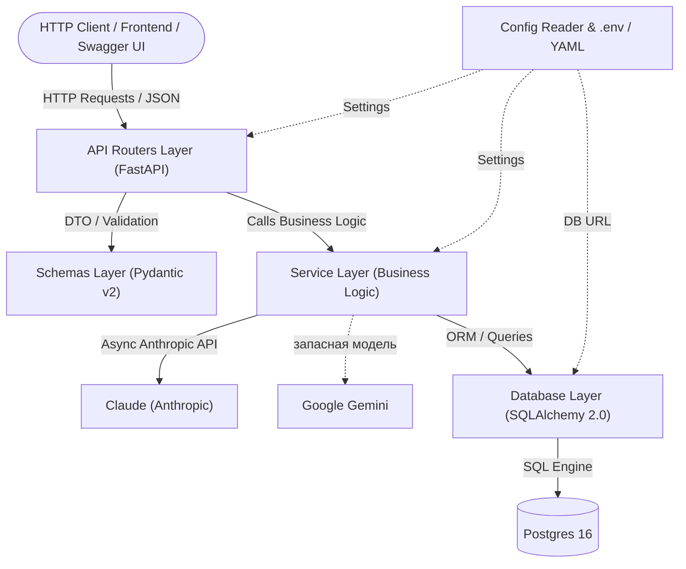
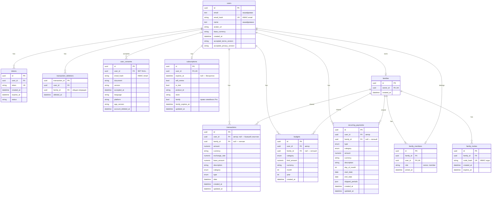

# Архитектура и база знаний проекта GetBalance AI API

> [!NOTE]
> Данный документ является единым источником правды по архитектуре, модели данных, контрактам и правилам работы с проектом **GetBalance AI API**.

---

## 1. Назначение и стек технологий

**GetBalance AI API** — бэкенд-сервис (REST API) для персонального учета финансов с интеграцией искусственного интеллекта (Claude Haiku от Anthropic, запасная модель — Google Gemini) и возможностью пакетной офлайн-синхронизации.

* **Репозиторий**: `jbronxxx/getbalanceai_api`
* **Фреймворк**: FastAPI (Python 3.11+)
* **База данных и ORM**: PostgreSQL 16, SQLAlchemy 2.0 (Async Session, asyncpg)
* **Миграции**: Alembic
* **Валидация и DTO**: Pydantic v2 (`ConfigDict`, `Field`)
* **Аутентификация**: вход через Google и Apple (ID-токены), JWT (`PyJWT`), ротация Refresh-токенов
* **Интеграция с LLM**: Anthropic API (`claude-haiku-5-5`), запасная — Google Gemini API (`gemini-3.5-flash-lite`)
* **Кэширование**: Redis 7 (кэширование инсайтов и аналитических рекомендаций с отказоустойчивым graceful fallback). AOF, потолок `--maxmemory 256mb` с политикой `noeviction`: при заполнении запись отклоняется, а не вытесняет ключи — вытеснение могло бы удалить отозванные `jti`
* **Конфигурация**: Pydantic Settings + `.env`
* **Контейнеризация**: Docker & Docker Compose
* **Тестирование**: Pytest (`TestClient`, `httpx.AsyncClient`)

---

## 2. Архитектурный стиль и слои (Layered Architecture)

Проект спроектирован по принципам многослойной архитектуры с четким разделением ответственности (Separation of Concerns):



### Зоны ответственности слоев:
1. **API Routers (`app/routers/`)**: Прием и диспетчеризация HTTP-запросов, проверка прав доступа, сериализация ответов в единые форматы `ApiResponse[T]` и `ErrorResponse`. Сложной бизнес-логики не содержат.
2. **Service Layer (`app/services/`)**: Вся предметная логика, расчеты бюджетов, криптография, ротация токенов, интеграция с внешними LLM API и кэширование аналитики.
3. **Schemas (`app/schemas/`)**: Pydantic-схемы валидации входящих данных (Request DTO) и структуры ответов (Response DTO).
4. **Data Layer (`app/models/`, `app/database.py`)**: Определение схемы реляционных таблиц через декларативные модели SQLAlchemy 2.0 и управление жизненным циклом сессий `async_session_maker`.

---

## 3. Схема базы данных



### Таблицы:
* `users`: Пользователи системы (email в нижнем регистре; имя, аватар `avatar_url`, базовая расчетная валюта `base_currency`). `email` и `name` хранятся зашифрованными (`TEXT`, AES-256-GCM, см. «Шифрование имени и email»), поиск — по уникальному слепому индексу `email_hash` (HMAC-SHA256 адреса в нижнем регистре): один адрес в разном регистре даёт один аккаунт. `accepted_terms_version` / `accepted_privacy_version` — последние принятые версии документов (см. «Принятие юридических документов»)
* `user_consents`: История принятия соглашения и политики (GDPR ст. 7(1)): документ (CHECK `ck_user_consents_document`), версия, время, язык, платформа и версия приложения из заголовков OBS-02, слепой индекс email; имени, email и IP нет. Записи только добавляются. `user_id` → `users` — `ON DELETE SET NULL`: при удалении аккаунта запись остаётся с `account_deleted_at` и удаляется регламентной очисткой через 3 года
* `subscriptions`: Снимок доступа Pro из RevenueCat — одна строка на пользователя (`user_id` уникален): окончание оплаченного периода `expires_at` (дата продления или окончания; с учётом льготного периода магазина; null — бессрочный доступ, выданный вручную), `will_renew`, `is_trial`, `product_id`, `store`, право семейного Pro `family` и его срок `family_expires_at`. Строки нет — тариф Free; строка с прошедшим `expires_at` — тоже Free (см. «Тарифы и подписка»)
* `families`, `family_members`, `family_invites`: семейный Pro (FEAT-03, см. «Семейный Pro»). Владелец (`owner_id` уникален) тоже строка `family_members` с ролью `owner` (CHECK `ck_family_members_role`); `family_members.user_id` уникален — человек в одной семье. Приглашение хранит только HMAC кода (`app/pii.py` `secret_hash`), использованное и отозванное удаляется.
* Общие записи: `transactions`, `budgets`, `recurring_payments` имеют `family_id` (NULL — личная) и допускают `user_id` NULL — общая запись участника, удалившего аккаунт; CHECK `ck_<таблица>_owner` — есть автор или семья. FK `family_id` — `ON DELETE RESTRICT`: семью удаляет сервис, раздав записи авторам. Уникальность лимита — два частичных индекса: `uq_budgets_personal_period` (user_id, category, month, year) WHERE family_id IS NULL и `uq_budgets_family_period` (family_id, …) WHERE family_id IS NOT NULL. Индексы `transactions (family_id, date)`, `(family_id, updated_at)`
* Внешние ключи `transactions`, `budgets`, `tokens`, `transaction_deletions`, `recurring_payments`, `subscriptions` → `users` — `ON DELETE CASCADE`; связи `User` с `passive_deletes=True`: удаление аккаунта — один `DELETE` пользователя, без загрузки его данных в память
* `tokens`: refresh-токены сессий пользователей (SHA-256 хеш) со статусом (`active`, `revoked`, `expired`), временем отзыва `revoked_at` и преемником по ротации `replaced_by_id` (без внешнего ключа: пакетная очистка токенов не сканирует таблицу на каждую удалённую строку)
* `transactions`: Финансовые операции (доход/расход с категорией, датой и мультивалютными полями стандарта `NUMERIC(18, 2)` и `NUMERIC(18, 6)`: `amount`, `currency`, `exchange_rate`, `base_amount`; `updated_at` — время последней правки для ETag списка и выборки `GET /sync/changes`, индекс `(user_id, updated_at)`)
* `transaction_deletions`: Журнал удалённых транзакций (`transaction_id` — PK, `deleted_at`, индекс `(user_id, deleted_at)`). Удаление не оставляет следа в `transactions`, поэтому другие устройства узнают о нём только отсюда. Пишется при `DELETE /transactions/{id}` и `deleted_transaction_ids` в `/sync` (только для реально удалённых строк пользователя); запись снимается, если транзакция создана заново с тем же id. Хранится бессрочно
* `budgets`: Лимиты расходов по категориям (по месяцам и годам, поле `limit_amount` типа `NUMERIC(18, 2)` в валюте лимита `currency`, CHECK `ck_budgets_currency`)
* `recurring_payments`: Регулярные платежи и доходы (ЖКХ, кредит, связь, зарплата) — расписание, а не операции. Тип и категория (те же enum, что у `transactions`, совместимость категории с типом проверяется), ожидаемая сумма `NUMERIC(18, 2)` в своей валюте (`ck_recurring_payments_currency`), название `description` (может быть пустым), день месяца `day_of_month` 1–31 (`ck_recurring_payments_day_of_month`; в коротком месяце клиент берёт последний день), `start_date`, `end_date` (null — без срока), пропущенные месяцы `skipped_periods` (JSON-список `YYYY-MM`), `updated_at` для ETag. Записи не создаются сервером: приложение напоминает о платеже, а запись создаёт пользователь («Оплачено») с детерминированным id (платёж + месяц) — оплата с двух устройств не даёт дублей, оплаченный месяц узнаётся по записи. Удаление платежа прошлых записей не трогает
* `alembic_version`: Служебная таблица для отслеживания миграций. История миграций сжата в одну начальную (`t01901901901`, 11.11.2026)

### Перечисления и типы (Category, TransactionType, CurrencyCode):
* **Коды валют (`CurrencyCode`)**: централизованное перечисление поддерживаемых валют системы (`USD`, `EUR`), используемое в моделях, Pydantic-схемах и сервисе котировок.
Категории разделены на два множества для обеспечения валидности финансовых данных:
* **Категории доходов (`INCOME_CATEGORIES`)**: `salary` (зарплата), `freelance` (фриланс/подработка), `investments` (инвестиции/вклады), `transfers` (переводы и подарки), `cashback` (кэшбэк и бонусы), `sales` (продажи), `other` (прочее).
* **Категории расходов (`EXPENSE_CATEGORIES`)**: `food` (продукты и питание), `transport` (транспорт), `entertainment` (развлечения), `health` (здоровье и медицина), `subscriptions` (подписки и сервисы), `shopping` (покупки и одежда), `housing` (жильё и ЖКХ), `communication` (связь: телефон и интернет), `education` (образование), `family` (семья и дети), `car` (автомобиль), `gifts` (подарки), `travel` (путешествия), `beauty` (красота и уход), `other` (прочее).

**Мультивалютность и правила конвертации:**
1. **Модель хранения курсов (исторический settled rate против текущего live rate)**:
   - Поле `amount` хранит сумму в оригинальной валюте транзакции (`currency`). Допустимые коды валют строго ограничены справочником `CurrencyCode` и защищены ограничениями целостности на уровне БД (`ck_users_base_currency`, `ck_transactions_currency`).
   - Поля `exchange_rate` и `base_amount` в таблице `transactions` фиксируют финансовое состояние на момент совершения операции (исторический курс). Рыночные колебания курсов валют не меняют зафиксированные суммы прошлых транзакций, предотвращая искажение финансовой отчетности.
   - Текущие рыночные котировки (`CurrencyService`) используются исключительно для создания новых операций, сверки клиентского ввода и единовременного пересчета при осознанной смене базовой валюты профиля.
2. Единая точка согласования курсов и сумм — `CurrencyService.resolve_amounts(...)`. При совпадении валюты операции с базовой курс строго равен 1.0, а `base_amount = amount`. Для мультивалютных операций курс сверяется с серверным кросс-курсом котировок (допустимое отклонение задается `CLIENT_RATE_TOLERANCE_PERCENT`, по умолчанию 15%), а базовая сумма всегда вычисляется сервером по формуле `(amount * exchange_rate).quantize(0.01)`.
3. У каждого лимита своя валюта (`budgets.currency`, по умолчанию — базовая валюта пользователя на момент создания); `spent` и `remaining` возвращаются в ней. Расходы агрегируются одним SQL-запросом `SUM(amount)`/`SUM(base_amount)` с группировкой по категории, периоду и валюте операции, затем переводятся в валюту лимита: операции в той же валюте — по сумме чека, лимит в базовой валюте — по `base_amount` (исторический курс), остальные — по текущему кросс-курсу `CurrencyService.calculate_cross_rate`. Для ускорения фильтрации и использования планировщиком БД составного индекса `ix_transactions_user_id_type_date` применяются строгие диапазонные условия (`date >= start_date AND date < end_date`). `CurrencyService.get_rates()` вызывается только если у лимита не в базовой валюте есть траты в другой валюте; лимиты в базовой валюте читаются без обращения к котировкам. ETag курсы не учитывает: `spent` таких лимитов обновляется при следующей мутации данных (клиент считает траты локально).
   - Месяц — по часам клиента: заголовок `X-Timezone-Offset` (минуты от UTC) разбирает зависимость `get_client_timezone` (`app/routers/dependencies.py`), границы считает `app/services/period.py` (`month_bounds` — начало месяца в поясе клиента, переведённое в UTC). Период операции определяется попаданием даты в диапазон (`CASE`), а не `EXTRACT(month)` от UTC: иначе для UTC+5 траты 1-го числа до 05:00 уходили в прошлый месяц. Те же границы — в отпечатке и выборке AI-отчёта и в месяце по умолчанию `/insights`. Без заголовка — UTC. Смещение входит в ETag бюджетов; переходы на летнее время не учитываются (для UZ/KZ их нет).
4. **Централизованный модуль Redis (`app/redis.py`) и схема ключей**:
   - Единый пул соединений и синглтон-клиент (`get_redis()`) с корректным освобождением ресурсов (`close_redis()`) в `lifespan` FastAPI (рядом с `engine.dispose()`).
   - Устранение перекрестных импортов: сервисы импортируют функции управления кэшем из `app.redis`, исключая скрытые зависимости (например, `budget_service` от `ai_service`).
   - Централизованные билдеры ключей:
     - `REDIS_KEY_CURRENCY_RATES = "currency_rates:USD"` — основной кэш котировок (TTL из конфигурации).
     - `REDIS_KEY_CURRENCY_RATES_LAST_SUCCESSFUL = "currency_rates:last_successful:USD"` — постоянный источник резервных котировок без TTL.
     - `get_budgets_version_key(user_id)` -> `budgets_version:{user_id}` — версия ETag для бюджетов (TTL 30 дней: истечение лишь один раз меняет ETag).
     - `get_insights_cache_key(user_id, locale, currency, month, year)` -> `insights_cache:{user_id}:{locale}:{currency}:{month}:{year}` — сохранённый AI-отчёт за месяц вместе с отпечатком данных периода (TTL 400 дней).
     - `plan_usage_key(feature, user_id, window)` (`app/services/plan_limits.py`) -> `plan_usage:{feature}:{user_id}:{окно}` — счётчик функции в окне лимита тарифа (см. «Тарифы и подписка»).
     - `get_insights_user_patterns(user_id)` — маски для неблокирующей инвалидации через `scan_iter` (включая счётчики `insights_tx_count:*` прежней схемы до истечения их TTL).
5. Справочник котировок обслуживается сервисом `CurrencyService` с многоуровневым кэшированием в Redis (основной кэш, постоянный ключ успешных котировок, и негативный кэш с TTL 180 с при падении внешнего шлюза для предотвращения блокировок очереди запросов, пул соединений через переиспользуемый `httpx.AsyncClient`). При сбое шлюза и отсутствии кэша возвращается базовая таблица с фиксированной датой ее актуализации (`FALLBACK_RATES_UPDATED_AT`), исключая фиктивные отметки «свежести». При пакетной синхронизации котировки запрашиваются лениво — только при наличии мультивалютных транзакций.
6. **Политика и механика пересчета финансов при смене базовой валюты**:
   - При обновлении `base_currency` через `PATCH /api/v1/auth/me` (защищенном rate limiter 10/мин) сервис атомарно пересчитывает курсы и `base_amount` всех транзакций единым пакетным SQL `UPDATE ... values(exchange_rate=case(...), base_amount=case(...))` без загрузки объектов в память Python.
   - Для транзакций в новой базовой валюте курс фиксируется строго в 1.0, а `base_amount = amount`.
   - Курсы передаются в SQL литералами `NUMERIC` без масштаба: литерал, умножаемый на `amount`, иначе наследует его тип `Numeric(18, 2)`, asyncpg приводит параметр к `NUMERIC(18, 2)`, и курс округлялся до двух знаков (1/0.92 для EUR -> USD давал 1.09 вместо 1.086957).
   - Полная математическая обратимость: цикл смены валюты (например, EUR -> USD -> EUR) полностью возвращает исходные значения без накопления погрешности IEEE-754.
   - Лимиты бюджетов не пересчитываются: у каждого своя валюта (`budgets.currency`).
   - Заголовок `ETag` бюджетов пользователя инвалидируется в Redis, а кэш AI-инсайтов пользователя очищается через неблокирующий `scan_iter` и `unlink` (исключая O(N) `KEYS` и опасный `FLUSHDB`).
7. **Отказоустойчивость, оптимизация синхронизации и предотвращение race conditions**:
   - В `BudgetService.create` создание/обновление лимита выполняется через атомарный `insert().on_conflict_do_update(...)` (совместимый с PostgreSQL и SQLite), предотвращая ошибки параллельного создания лимитов по одной категории.
   - Ограничение объема запроса: не более 500 элементов на списки транзакций, бюджетов и регулярных платежей в `POST /api/v1/sync`.
   - Границы значений: суммы и лимиты не больше `10^12`, описание в `/sync` обрезается до длины колонки (255); запись, чья сумма в базовой валюте не помещается в `Numeric(18, 2)`, уходит в `rejected`. Офлайн-очередь клиента повторяет батч целиком, поэтому одна запись вне границ не должна давать 500 на весь батч.
   - Идемпотентность повтора: клиент присваивает новым записям UUID до отправки; повтор батча после потерянного ответа обновляет те же строки, а не создаёт дубли.
   - Устранение проблемы N+1: пакетное удаление бюджетов объединено в единый SQL-запрос (`or_`, `tuple_().in_()`), выборка существующих бюджетов ограничена ключами пакета, а коммит с `expire_on_commit=False` исключает цикл запросов `refresh()`.
   - Изоляция конфликтов ID: чужие или конфликтующие идентификаторы транзакций и бюджетов не вызывают ошибку целостности (500) и не роняют весь батч, а безопасно возвращаются клиенту в списке `rejected` с кодом причины (`code`: `ID_CONFLICT`, `INVALID_CURRENCY`, `INVALID_TRANSACTION_AMOUNT`, `INVALID_CATEGORY`, `INVALID_AMOUNT`, `INVALID_SYNC_ITEM`) и текстом (`reason`). Записи `transactions` и `budgets` проверяются схемой по одной (`SyncPayload.split_invalid_items`, результат — в приватном атрибуте `invalid_items`, не в поле запроса): невалидная запись уходит в `rejected`, а не роняет батч `422`.
   - Идемпотентный UPSERT бюджетов по ID или составному ключу `(category, month, year)` с дедупликацией элементов.
   - Регулярные платежи (`RecurringPaymentService`): в `/sync` — `recurring_payments` (создание или полная замена по клиентскому id, чужой id — `ID_CONFLICT`) и `deleted_recurring_payment_ids`; загрузка — весь список `GET /api/v1/recurring-payments` (у пользователя их единицы): клиент сверяет его с локальным, отсутствующий платёж удалён на другом устройстве, поэтому журнала удалений нет. ETag — по `count` и `max(updated_at)`. Разбор `If-None-Match` и ответ 304 — общий помощник `not_modified_response` (`app/routers/dependencies.py`) для бюджетов, транзакций и регулярных платежей.
   - Любые мутации бюджетов или транзакций (создание, удаление, синхронизация) автоматически инвалидируют ETag бюджетов пользователя (`BudgetService.invalidate_etag`).
   - ETag списка транзакций считается по `count` и `max(transactions.updated_at)`: `updated_at` обновляется через `onupdate` и при ORM-правке в `/sync`, и при пакетном `UPDATE` пересчёта валюты, поэтому правка с другого устройства не даёт 304.
   - Инкрементальная загрузка (`GET /api/v1/sync/changes`): клиент передаёт `since` — `server_time` первой страницы прошлой синхронизации — и получает транзакции с `updated_at` позже и id из `transaction_deletions` позже. Окно расширяется на `CHANGES_OVERLAP` (1 мин) назад: строка видна после коммита, а `updated_at` ставится при записи. Страницы по `(updated_at, id)`, удалённые — только на первой странице. Без `since` — все транзакции (первая синхронизация устройства). Время отметки берётся с сервера, часы телефона не участвуют.

**Правила валидации:**
1. При создании или синхронизации транзакций категория строго сопоставляется с типом операции: доходы не могут быть отнесены к сугубо расходным статьям, а расходы — к доходным источникам.
2. Бюджеты (`budgets`) могут устанавливаться исключительно для расходных категорий (`EXPENSE_CATEGORIES`).

---

## 4. Структура каталогов

```
getbalanceai_api/
├── app/                        # Основной пакет приложения
│   ├── legal/                  # Тексты публичных страниц (ru/en): privacy.py, terms.py, delete_account.py, ui.py;
│   │                           # versions.py — версии соглашения и политики с «Что изменилось», archive.py — прежние тексты (модули `<документ>_<версия>.py`)
│   ├── models/                 # ORM-модели SQLAlchemy 2.0
│   │   └── models.py           # Модели User, Token, Transaction, Budget и Enum-типы
│   ├── routers/                # Эндпоинты FastAPI (Контроллеры)
│   │   ├── auth.py             # Авторизация (/google, /apple, /refresh, /logout, /me)
│   │   ├── budgets.py          # CRUD бюджетов и расчет ETag
│   │   ├── currencies.py       # Котировки валют (/api/v1/currencies/rates)
│   │   ├── dependencies.py     # Общие зависимости: часовой пояс клиента (X-Timezone-Offset)
│   │   ├── insights.py         # AI-аналитика расходов (/api/v1/insights)
│   │   ├── public.py           # Публичные HTML-страницы (/privacy, /terms, /delete-account)
│   │   ├── sync.py             # Пакетная офлайн-синхронизация и выборка изменений (HTTP, логика в SyncService)
│   │   ├── transactions.py     # CRUD транзакций и расчет ETag
│   │   ├── subscriptions.py    # Подписка: вебхук RevenueCat и обновление статуса после покупки
│   │   └── voice.py            # Голосовой ввод: разбор фразы на черновики записей (/api/v1/voice/parse)
│   ├── schemas/                # Pydantic v2 DTO
│   │   └── schemas.py          # ApiResponse[T], ErrorResponse, схемы сущностей
│   ├── services/               # Слой бизнес-логики
│   │   ├── ai_service.py       # ИИ-отчёт через LLM и кэширование инсайтов
│   │   ├── llm.py              # Общее для вызовов LLM: клиент Claude и Gemini, вызов с повторами и запасной моделью, причины сбоев, разбор JSON, очистка текста для промпта
│   │   ├── voice_service.py    # Разбор голосового ввода на черновики записей через LLM
│   │   ├── voice_texts.py      # Инструкция и запрос к модели для голосового ввода (ru, en)
│   │   ├── insights_formatting.py # Названия категорий и формат сумм для AI-отчёта, как в приложении
│   │   ├── insights_texts.py   # Тексты AI-отчёта на языке пользователя: инструкция и запрос к модели, подписи данных, служебные сообщения
│   │   ├── auth_service.py     # OAuth-вход, JWT, ротация и очистка токенов
│   │   ├── budget_service.py   # Лимиты бюджетов и подсчет расходов
│   │   ├── consent_service.py  # Принятие документов: запись согласий, проверка версии, срок хранения
│   │   ├── currency_service.py # Получение и кэширование котировок валют (Redis, fallback)
│   │   ├── legal_pages.py      # Выбор языка и HTML-рендеринг публичных страниц
│   │   ├── period.py           # Границы месяцев в часовом поясе клиента
│   │   ├── plan_limits.py      # Лимиты функций по тарифу: окна сутки/месяц по часам клиента, счётчики в Redis
│   │   ├── revenuecat.py       # Клиент REST API RevenueCat: доступ Pro покупателя, удаление покупателя
│   │   ├── subscription_service.py # Тариф пользователя, снимок подписки, вебхук RevenueCat, удаление покупателя
│   │   ├── sync_service.py     # Пакетная офлайн-синхронизация: upsert, удаления, rejected, откат батча; выборка изменений
│   │   ├── transaction_deletion_log.py # Журнал удалённых транзакций для GET /sync/changes
│   │   └── transaction_service.py # Операции с транзакциями и генерация ETag
│   ├── tasks/                  # Фоновые и регламентные процессы
│   │   └── token_cleanup.py    # Регламентная очистка устаревших токенов и просроченных согласий
│   ├── database.py             # Подключение к PostgreSQL, SessionLocal, UnitOfWork и get_db
│   ├── exceptions.py           # Доменные исключения (AppException) и коды ошибок ErrorCode
│   ├── limiter.py              # Инициализация Rate Limiter (SlowAPI)
│   ├── pii.py                  # Шифрование имени и email (AES-256-GCM) и слепой индекс email (HMAC)
│   └── redis.py                # Централизованный клиент Redis и генераторы ключей
├── config_reader/              # Загрузка и объединение YAML + .env
│   └── config_reader.py
├── logger/                     # Структурированное логирование
│   ├── logger.py
│   └── request_log.py          # Журнал HTTP-запросов: JSON-строка на запрос
├── migrations/                 # Alembic миграции
│   ├── versions/
│   ├── env.py
│   └── script.py.mako
├── scripts/                    # CLI-скрипты и утилиты
│   ├── cleanup_tokens.py       # Запуск регламентной очистки токенов через cron/CLI
│   ├── delete_user_by_email.py # Административное удаление аккаунта по email (запросы без входа в приложение)
│   ├── grant_pro.py            # Ручная выдача и отзыв Pro по email (строка `manual` в subscriptions)
│   ├── rotate_pii_keys.py      # Ротация ключей шифрования имени и email: перешифровка и пересчёт слепого индекса
│   └── issue_load_test_tokens.py # Тестовые пользователи с историей и токенами для нагрузочного теста; cleanup
├── loadtest/                   # Сценарии Locust, профили нагрузки и run.sh (отчёты — в reports/<время>_<сценарий>/); не входит в Docker-образ
├── tests/                      # Набор тестов Pytest
│   ├── conftest.py             # Фикстуры тестов
│   ├── test_ai_service.py      # Модульные тесты AIService
│   ├── test_insights_formatting.py # Формат категорий и сумм в данных для LLM
│   ├── test_llm.py             # Вызов LLM: запрос к Claude и Gemini, повторы, отказ модели, запасная модель, причины сбоев, общий срок
│   ├── test_voice.py           # Голосовой ввод: контракт, проверка ответа модели, лимит тарифа, ошибки, журналы
│   ├── test_subscriptions.py   # Тарифы и подписка: RevenueCat (разбор, клиент, вебхук, refresh), профиль с лимитами, удаление покупателя
│   ├── test_auth.py            # Интеграционные тесты профиля пользователя и базовой валюты
│   ├── test_auth_service.py    # Модульные и интеграционные тесты аутентификации
│   ├── test_delete_user_by_email.py # Тесты CLI-скрипта удаления пользователя по email
│   ├── test_grant_pro.py       # Тесты CLI-скрипта ручной выдачи и отзыва Pro
│   ├── test_pii.py             # Шифрование имени и email: шифр, хранение в БД, поиск, API, журналы, ротация ключей
│   ├── test_issue_load_test_tokens.py # Тесты подготовки и очистки данных нагрузочного теста
│   ├── test_budget_service.py  # Модульные тесты сервиса бюджетов
│   ├── test_budgets.py         # Интеграционные тесты эндпоинтов бюджетов
│   ├── test_errors.py          # Тесты контрактов ошибок
│   ├── test_fintech_integrity.py # Тесты точности Decimal и индексов БД
│   ├── test_income_categories.py # Тесты категорий доходов и валидации типов
│   ├── test_multi_currency.py  # Тесты мультивалютности
│   ├── test_observability.py   # Тесты healthcheck и сквозного Correlation ID
│   ├── test_request_log.py     # Журнал запросов: состав записи, без тел запросов, токенов и ПДн
│   ├── test_public_pages.py    # Тесты публичных страниц (/privacy, /terms, /delete-account)
│   ├── test_redis_module.py    # Модульные тесты централизованного клиента и ключей Redis
│   ├── test_oauth_verification.py # Проверка ID-токенов Google/Apple на реальной RSA-подписи (aud, iss, email_verified)
│   ├── test_security.py        # Тесты CORS, Rate Limiting, ключа лимитера, удалённых эндпоинтов входа по паролю и prod-настроек
│   ├── test_sync.py            # Интеграционные тесты офлайн-синхронизации
│   ├── test_sync_changes.py    # GET /sync/changes: since, удалённые, повторное создание, страницы, чужие данные
│   ├── test_sync_service.py    # Unit-тесты SyncService: итог, дубли в батче, откат при ошибке БД
│   ├── test_transaction_service.py # Тесты сервиса транзакций
│   ├── test_transactions.py    # Тесты транзакций и кэширования инсайтов
│   └── test_unit_of_work_and_cleanup.py # Тесты Unit of Work и регламентной очистки токенов
├── .env.example
├── .gitignore
├── alembic.ini
├── app_config.yaml
├── Dockerfile
├── docker-compose.yml
├── main.py                     # Точка входа, lifespan, обработчики ошибок
├── README.md
├── requirements.txt            # Зависимости приложения
├── requirements-dev.txt        # Зависимости для тестирования и разработки
├── RESPONSE_FORMAT.md          # Спецификация форматов ответов API
├── ARCHITECTURE.md             # Архитектурная документация сервиса
└── TEST_CHECKLIST.md           # Чек-лист проверок (автотесты и QA)
```

---

## 5. Стандарты контрактов API и соглашения

1. **Единый формат ответов**:
   * **Успешный ответ**: `ApiResponse[T]`
     ```json
     {
       "status": "success",
       "data": {},
       "message": null
     }
     ```
   * **Ответ с ошибкой**: `ErrorResponse` (со строгим машиночитаемым `ErrorCode` в формате `SCREAMING_SNAKE_CASE`):
     ```json
     {
       "status": "error",
       "code": "BUDGET_LIMIT_EXCEEDED",
       "message": "Превышен лимит бюджета для данной категории",
       "details": {}
     }
     ```
   * **Простой ответ**: `BaseResponse` (для операций `delete` / `logout`).
   * Полная спецификация и примеры приведены в [`RESPONSE_FORMAT.md`](RESPONSE_FORMAT.md).

2. **Исключения**:
   * В контроллерах и сервисах выбрасываются доменные исключения `AppException` (`BadRequestException`, `NotFoundException`, `UnauthorizedException`) из `app.exceptions`, которые автоматически конвертируются в `ErrorResponse` глобальным обработчиком в `main.py`.

3. **Аутентификация и сессии**:
   * Используется схема с двумя токенами: короткоживущий `access_token` (JWT) + долгоживущий `refresh_token` (JWT).
   * **Stateless JWT**: `access_token` не сохраняется в базу данных и валидируется криптографически без обращения к СУБД.
   * **Сессия**: access и refresh токены выдаются парой (`AuthService._issue_token_pair`) при входе и ротации; `id` строки refresh-токена в `tokens` записывается в access-токен как claim `sid`.
   * **Logout** (`POST /auth/logout`, `DELETE /auth/me`) завершает только текущую сессию: refresh-токен с `id = sid` помечается `revoked`, а `jti` access-токена записывается в Redis (`revoked_jti:{jti}`) с TTL до истечения токена. `get_current_user` проверяет этот ключ, поэтому отзыв сразу действует во всех воркерах gunicorn; другие устройства пользователя не затрагиваются. Выход завершается только после подтверждённой записи в Redis: при его недоступности ответ `503 SERVICE_UNAVAILABLE`, транзакция откатывается вместе с отзывом refresh-токена, токены остаются действующими, а `DELETE /auth/me` не удаляет аккаунт. У access-токенов, выданных до появления `sid`, при logout отзывается только сам access-токен; после ближайшей ротации пара уже связана.
   * Реализован паттерн **Refresh Token Rotation**: при обновлении токена старый refresh-токен помечается в БД как `revoked` (с `revoked_at`), а клиенту выдается новая пара токенов. Проверка и отзыв выполняются одним `UPDATE ... WHERE status='active' RETURNING`: из параллельных запросов с одним токеном ротацию выполняет только один, остальные обрабатываются как повтор ротации — живой остаётся одна пара.
   * **Обнаружение повторного использования**: отозванный refresh-токен, предъявленный позже 30 секунд после отзыва (`REFRESH_REUSE_GRACE`), считается украденным — отзываются все активные сессии владельца, отзыв фиксируется `commit` до ответа `401 TOKEN_REVOKED`.
   * **Повтор ротации**: при ротации старый токен связывается с преемником (`replaced_by_id`). Повтор в пределах окна (клиент не получил ответ: обрыв, таймаут, уход в фон) отзывает ещё не использованного преемника и выдаёт новую пару — у цепочки остаётся одна активная сессия, и клиент не выходит из аккаунта. Если преемника уже ротировали или из его сессии вышли, а также у токенов, ротированных до появления `replaced_by_id`, повтор в окне отклоняется `401 TOKEN_REVOKED` без отзыва других сессий.
   * **Вход по паролю выведен из API**: `/auth/register` и `/auth/login` удалены. Иначе можно было заранее зарегистрировать аккаунт на чужой email с паролем: при входе владельца через Google аккаунт привязывался по email, а пароль злоумышленника продолжал работать.
   * **OAuth и синхронизация профиля**:
     * При входе через Google (`POST /api/v1/auth/google`) и Apple (`POST /api/v1/auth/apple`) проверяются подпись (JWKS провайдера; ключи кэшируются на час в клиенте уровня класса `AuthService`, то есть один раз на воркер, а не на запрос), срок, `aud` и `iss` ID-токена (`AuthService._decode_oauth_token`). `aud` должен совпасть с одним из client ID из `GOOGLE_CLIENT_ID` / `APPLE_CLIENT_ID` (список через запятую — Android, iOS, Web); без настроенных client ID вход через провайдера отклоняется. `iss`: Google — `accounts.google.com` или `https://accounts.google.com`, Apple — `https://appleid.apple.com`. Для Google дополнительно требуется `email_verified=true`.
     * Эндпоинт Google поддерживает опциональные поля `avatar_url` и `name` в теле запроса в качестве fallback при кешировании ID-токена Google Play Services / GIS на мобильном клиенте.
     * При наличии нового аватара `user.avatar_url` автоматически обновляется в БД. Если имя пользователя оставалось дефолтным (префикс email), оно актуализируется на реальное имя из Google.
     * `TokenResponse` возвращает профиль `user` (`UserResponse`), что позволяет клиенту мгновенно получить актуальное состояние аккаунта без дополнительного запроса к `/me`.

4. **Безопасность и ограничение частоты запросов (Security & Rate Limiting)**:
   * **CORS Middleware**: Подключен `CORSMiddleware` с параметризацией разрешенных ориджинов, методов и заголовков через `app_config.yaml` и переменные окружения (`CORS_ORIGINS`, `CORS_ALLOW_METHODS`, `CORS_ALLOW_HEADERS`). `CORS_ALLOW_CREDENTIALS` по умолчанию `false`: клиенты авторизуются Bearer-токеном, cookie не используются.
   * **Rate Limiting**: Используется `slowapi` для защиты критичных эндпоинтов авторизации (`/google`, `/apple` — 5 запросов/мин) ресурсоемких AI-инсайтов (`/insights` — 10 запросов/мин), голосового ввода (`/voice/parse` — 20/мин), `POST /sync` (60/мин), `GET /sync/changes` (120/мин) и `POST /transactions` (120/мин) — по пользователю, `/refresh` — 30/мин по IP (access-токен к моменту обновления обычно истёк; устройство обновляет токены примерно раз в час, так что лимит с запасом покрывает клиентов за общим NAT). Клиент завершает сессию только на 401 от `/refresh`, на 429 повторяет позже. При превышении возвращается стандартизированный `ErrorResponse` с HTTP 429 и кодом `RATE_LIMIT_EXCEEDED`.
     * Ключ лимита — `user:<sub>` только из access-токена с проверенной подписью и сроком (`app/limiter.py`), иначе IP клиента: поддельный `sub` не даёт отдельного счётчика.
     * IP клиента за nginx: nginx перезаписывает `X-Forwarded-For` значением `$remote_addr`, gunicorn запущен с `--forwarded-allow-ips "*"` (gunicorn 23 не принимает подсеть CIDR; порт 8000 доступен только из сети Docker и с хоста).
     * Счётчики хранятся в `RATE_LIMIT_STORAGE_URI` (в docker-compose — Redis, общий для 4 воркеров gunicorn; по умолчанию `memory://`, например в тестах). При недоступности Redis лимиты временно считаются в памяти воркера (`in_memory_fallback_enabled`), запросы не падают.
   * **Сбой Redis**: `get_current_user` при недоступном хранилище отзывов отвечает `503 SERVICE_UNAVAILABLE` (не 500 и не 401 — клиент не завершает сессию); `/health` проверяет БД и Redis.
   * **Защита продакшн-конфигурации**: `APP_DEBUG` по умолчанию `false`. При старте в режиме `debug=False` блокируется запуск с дефолтным или пустым `SECRET_KEY`, без своих `PII_ENCRYPTION_KEYS` и `PII_HMAC_KEY` (ключи разработки из кода запрещены), без `GOOGLE_CLIENT_ID` (`APPLE_CLIENT_ID` необязателен — без него вход через Apple отклоняется) и с `CORS_ORIGINS=*` вместе с `CORS_ALLOW_CREDENTIALS=true`.
   * **Шифрование имени и email (`app/pii.py`)**: колонки `users.email` и `users.name` имеют тип `EncryptedString` (`app/models/models.py`): значение шифруется AES-256-GCM при записи и расшифровывается при чтении, код сервисов и ответы API работают с открытым текстом. Формат — `<id ключа>:<base64(nonce + шифртекст)>`, nonce случайный, имя колонки входит в AAD (шифртекст email не подставить в колонку имени). Ключи — только в окружении (`PII_ENCRYPTION_KEYS`: `id:ключ` через запятую, первый — текущий; `PII_HMAC_KEY`), в БД и её резервных копиях их нет; неверный формат ключей — отказ при старте (`lifespan`).
     * Поиск по email — `User.email_matches(email)` (слепой индекс `email_hash`, пересчитывается валидатором при каждой записи `email`). Сравнение зашифрованной колонки в SQL (`==`, `like`, сортировка) запрещено типом и падает с `TypeError`, а не находит молча ничего. Длина открытого значения ограничена как раньше (email 255, имя 100).
     * Ротация — `scripts/rotate_pii_keys.py` (перешифровка текущим ключом и пересчёт индекса, порядок — в README). Смена `PII_HMAC_KEY` — только с остановленным API.
     * Движок БД создаётся с `hide_parameters=True`: текст ошибок SQL, который уходит в журнал, не содержит значений запроса (открытых имени и email до шифрования, описаний операций). В журналах пользователь обозначается только `user_id`.

5. **Управление транзакциями и пулом соединений (Unit of Work, get_db & Pool Resilience)**:
   * **Чистый слой сервисов**: Сервисы (`TransactionService`, `BudgetService`, `AuthService`) не управляют состоянием транзакции напрямую (`commit`/`rollback`), а только оперируют объектами (`db.add()`, `db.delete()`, `db.flush()`).
   * **Автоматическое управление транзакциями**: Зависимость `get_db` в FastAPI автоматически выполняет `commit()` при успешной обработке запроса и `rollback()` при возникновении исключения.
   * **Контекстный менеджер UnitOfWork**: Предоставляет контекстный менеджер `with UnitOfWork() as session:` для атомарных составных операций вне HTTP-запросов (в фоновых задачах, CLI-скриптах и тестах).
   * **Размер пула**: `DB_POOL_SIZE=5`, `DB_MAX_OVERFLOW=10` на воркер — 4 воркера × 15 = 60 соединений, ниже `max_connections=100` Postgres с запасом для alembic, бэкапа и скриптов.
   * **Отказоустойчивость пула соединений (Pool Resilience)**: В `create_async_engine` включен `pool_pre_ping=True` (пессимистическая проверка доступности соединений перед выдачей из пула для защиты от `InterfaceError: connection is closed` при перезапуске БД или сбросе idle-соединений), а также `pool_recycle=1800` для упреждающей ротации TCP-сессий и корректное освобождение ресурсов `engine.dispose()` в `lifespan`.

6. **Фоновые и регламентные процессы (Token Cleanup)**:
   * **Периодическая очистка токенов**: Корутина `periodic_token_cleanup` (`app/tasks/token_cleanup.py`) запускается в `lifespan` каждого воркера gunicorn и удаляет истекшие или отозванные токены старше 30 дней (`expires_at < now() - interval '30 days'`), а затем записи `user_consents` удалённых аккаунтов старше `CONSENT_RETENTION_DAYS` (3 года после `account_deleted_at`).
   * **Один запуск на кластер**: раз в час каждый воркер пытается занять блокировку `lock:token_cleanup` в Redis (`SET NX EX 86400`). Очистку выполняет только воркер, занявший её, — не чаще раза в сутки; остальные пропускают проверку (DEBUG). Сутки отсчитывает TTL блокировки, а не таймер процесса, поэтому рестарты при деплое не откладывают очистку. При сбое очистки блокировка снимается, и ближайшая проверка любого воркера повторяет её; при недоступном Redis проверка пропускается (WARNING), а не выполняется всеми воркерами.
   * **Автономный CLI-скрипт**: Для запуска регламентной очистки через системный планировщик (cron, Kubernetes CronJob) реализован скрипт `scripts/cleanup_tokens.py` с поддержкой параметра `--days`.
7. **Принятие юридических документов (LEG-01)**:
   * Вход (`POST /auth/google`, `/auth/apple`) требует `accept_legal: true` — отметку на экране входа (иначе `422`); она принимает текущие версии соглашения и политики (`ConsentService.accept_current`). Запись в `user_consents` добавляется только при смене версии, повторный вход историю не множит.
   * `GET /api/v1/legal` (без авторизации) — текущие версии и «Что изменилось» на языке `lang` → `X-App-Language` → `Accept-Language` → `en`. `POST /api/v1/legal/accept` — принятие показанных версий (экран новой версии соглашения, уведомление о политике); не текущая версия — `409 LEGAL_VERSION_OUTDATED` с `current_version` в `details`.
   * Доступ к данным: роутеры транзакций, бюджетов, регулярных платежей, синхронизации, ИИ-отчёта, голосового ввода и `PATCH /auth/me` используют `get_consented_user` — без принятой текущей версии соглашения `403 TERMS_NOT_ACCEPTED`. `GET /auth/me`, выход, `DELETE /auth/me` и `/legal/accept` — на `get_current_user`. Новая версия политики доступ не закрывает: только `legal.privacy_accepted=false` в профиле.
   * Статус в профиле — вычисляемое поле `UserResponse.legal` (текущие версии и `*_accepted`) по колонкам `users.accepted_*_version`, без запроса к истории.
   * Удаление аккаунта не удаляет согласия: `ConsentService.mark_account_deleted` ставит `account_deleted_at`, `user_id` обнуляет БД. Найти запись можно по слепому индексу email (`scripts/rotate_pii_keys.py` пересчитывает его в согласиях живых аккаунтов; для удалённых старый `PII_HMAC_KEY` хранить вне сервера до истечения срока). Основание хранения — защита от правовых претензий (GDPR ст. 17(3)(e)); срок 3 года — до подтверждения юристом.
8. **Публичные юридические страницы (Google Play / App Store)**:
   * `GET /privacy`, `GET /terms`, `GET /delete-account` (`app/routers/public.py`, без авторизации, вне `/api/v1`, не входят в OpenAPI) возвращают адаптивный `HTMLResponse` в цветах бренда `#0D9488` (светлая и тёмная тема).
   * Язык — `?lang=ru|en`, иначе по `Accept-Language`, иначе `en` (`resolve_language`). Неподдерживаемое значение `lang` игнорируется и в разметку не попадает. Ответ кэшируется (`Cache-Control: public, max-age=3600`, `Vary: Accept-Language`).
   * Тексты хранятся в пакете `app/legal/` (данные), рендеринг и выбор языка — `app/services/legal_pages.py`; весь пользовательский контент экранируется через `html.escape`. Контактный email — `SUPPORT_EMAIL` в `app/legal/ui.py`.
   * Страница удаления описывает удаление в приложении (*Профиль → Удалить аккаунт*), перечень безвозвратно удаляемых данных и удаление по email без входа в приложение (срок — 30 дней). URL указываются в Play Console (Data Safety, Privacy Policy) и открываются из мобильного приложения.
   * Nginx проксирует пути на API, кроме закрытого `/metrics` и `/docs`, `/redoc`, `/openapi.json` за basic auth (см. раздел 7). Для `/privacy`, `/terms`, `/delete-account` в `nginx/conf.d/default.conf` действует лимит `5r/s` на IP (`limit_req_zone` по ключу из `map $uri`, `burst=20 nodelay`, при превышении — `429`); остальные пути лимитом Nginx не затрагиваются.
   * Сроки хранения, указанные в текстах, должны совпадать с настройками: резервные копии БД — 7 последних файлов `scripts/backup_db.sh` при ежедневном cron (≈7 суток) и не более 3 копий перед деплоем (`predeploy`, не дольше 7 суток); зашифрованные копии в Cloudflare R2 удаляются lifecycle-правилом бакета через 7 дней, логи Loki — 30 дней. При изменении настроек обновляйте `app/legal/`.
   * **Версии документов** (`app/legal/versions.py`): у соглашения и политики своя история `LEGAL_HISTORY`, версия — дата вступления в силу (ISO), последняя — текущая; к каждой версии — 1–3 пункта «Что изменилось» на всех языках. Дата на странице берётся из текущей версии (`format_date`). `?version=ГГГГ-ММ-ДД` показывает прежний текст из `app/legal/archive.py`, неизвестная версия — `404`. Выпуск новой версии: скопировать текущие тексты документа в модуль `app/legal/<документ>_<версия>.py` (как `privacy_2026_11_13.py`, `terms_2026_11_13.py`) и подключить в `ARCHIVE` под прежней версией, поправить тексты, добавить `LegalVersion` в конец истории (тест проверяет, что все прежние версии есть в архиве).
   * Запросы на удаление по email выполняются администратором скриптом `scripts/delete_user_by_email.py`: он находит пользователя по слепому индексу (`AuthService.find_user_by_email`) и вызывает `AuthService.delete_account` (те же шаги, что у `DELETE /auth/me`: каскадное удаление в БД и очистка ключей Redis).
   * Нагрузочное тестирование прода: `scripts/issue_load_test_tokens.py` создаёт пользователей только с email `loadtest+…@getbalanceai.test` (зарезервированный домен), вставляет их историю пачками напрямую в БД (без API и его лимитов) и выдаёт токены через `AuthService._issue_token_pair`; `cleanup` удаляет их по этому шаблону каскадом (email зашифрован, поэтому адреса расшифровываются в скрипте и отбираются по шаблону, а не `LIKE` в SQL), реальные пользователи не затрагиваются. Входа по паролю для тестов нет. Сценарии и критерии — `loadtest/README.md`.


---


## 6. Специфика AI Service (`app/services/ai_service.py`)

Сервис `AIService` формирует персонализированные финансовые рекомендации на основе транзакций и соблюдения лимитов бюджетов пользователя:
* **Модель и клиент**: `claude-haiku-5-5` (`AI_MODEL`) с адаптивными размышлениями и `effort` low (`AI_EFFORT`) — выбраны по итогам замера себестоимости и проверки качества (AI-01, AI-02); запасная — `gemini-3.5-flash-lite` (`AI_FALLBACK_MODEL`, другой провайдер). Сервисы вызывают `LLMClient.generate(LLMRequest(kind, system, prompt))` (`app/services/llm.py`): один клиент на процесс (`get_llm_client`, общий пул соединений), в тестах — мок с `generate` через конструктор (`client=`). Провайдер — по префиксу имени модели (`claude-` — Anthropic, иначе Google).
* **JSON-ответ**: системная инструкция требует JSON-объект; у Gemini дополнительно `response_mime_type="application/json"`. Общий помощник `extract_json()` извлекает объект и при markdown-обёртке или поясняющем тексте. Ответ Claude может начинаться с блоков размышлений — текст берётся только из блоков `text`. Sampling-параметры Claude Haiku 5.5 не принимает: `temperature=0` голосового разбора уходит только в Gemini.
* **Учет бюджетов и обезличивание**: В системную сводку `build_summary` включаются два блока: 1) Сводка по лимитам категорий на месяц (`категория | лимит | потрачено | остаток | статус превышения`, суммы — в валюте лимита); 2) Список транзакций (`дата | тип | категория | сумма`). Категории и суммы записываются так же, как в приложении на языке отчёта (`app/services/insights_formatting.py`: названия из локализаций приложения, «$1 234,50», «€12,50»), а системная инструкция требует повторять их дословно: без синонимов категорий («Еда» вместо «Питание»), без банковских кодов валют и без пересчёта сумм. Описания операций и регулярных платежей в модель не передаются (в свободном тексте бывают имена, адреса, телефоны, номера карт, и надёжно вычистить их нельзя); системная инструкция говорит модели, что описаний нет, и запрещает придумывать конкретные покупки. Имя, email и идентификатор пользователя в промпт тоже не попадают. Свободного текста пользователя в промпте отчёта нет — поэтому нет и поверхности для prompt injection.
* **Хранение отчётов и экономия вызовов LLM (Redis)**:
  - Отчёт за месяц хранится в `insights_cache:{user_id}:{locale}:{currency}:{month}:{year}` 400 дней (Redis с AOF) вместе с **отпечатком данных месяца** (`_month_fingerprint`: число и суммы `amount`/`base_amount` операций периода по категории, типу и валюте + категория, валюта и сумма каждого лимита) и числом операций.
  - Сохранённый отчёт актуален только при точном совпадении отпечатка: любое изменение операций или лимитов месяца (добавление, удаление, правка суммы, категории, валюты) — новая генерация при `generate=true`, чтобы суммы в тексте совпадали с экраном «Бюджет».
  - **Без вызова LLM** (`InsightResponse.state`): будущий месяц и месяц без операций — `no_data` (операции других месяцев в сводку не подмешиваются); меньше 7 операций за месяц (`MIN_TRANSACTIONS_FOR_INSIGHTS`) — `not_enough_data`, без сохранённого отчёта и лимита; `generate=false` — сохранённый отчёт или `not_generated`; если данные изменились после генерации, отчёт отдаётся с `is_outdated=true`.
  - Генерация расходует лимит тарифа (`plan_limits.py`, см. «Тарифы и подписка»): Free — 1 отчёт в календарный месяц, Pro — 5 в сутки; считается каждая генерация, за любой месяц отчёта. Сохранённый актуальный отчёт и `generate=false` лимит не тратят. Лимит исчерпан — 403 `PLAN_LIMIT_REACHED`; сохранённый (в том числе устаревший) отчёт клиент берёт запросом с `generate=false`.
  - Лимит занимается атомарным `INCR` до вызова LLM (из параллельных запросов проходит ровно лимит); при ошибке LLM возвращается `DECR`. Без Redis LLM не вызывается (`state=busy`): лимит платных вызовов не проверить.
  - Вызов LLM со всеми повторами ограничен `AI_REQUEST_TIMEOUT` (30 с); перед ним читающая транзакция завершается `commit`, и соединение возвращается в пул, а не простаивает всю генерацию.
  - Ошибка LLM (невалидный ключ, 503 провайдера, таймаут) не попадает в кэш и лимит: ответ `state=busy` с локализованным «помощники заняты».
  - `currency` и `locale` валидируются в роутере (`CurrencyCode`, код языка): они попадают в промпт и ключ кэша.
* **Интернационализация (i18n)**: всё, что уходит в модель (системная инструкция, запрос, подписи сводки, названия категорий, формат сумм), и служебные сообщения — на языке отчёта (`insights_texts.py`, `insights_formatting.py`): `ru` или `en`, любая другая локаль и локаль по умолчанию — `en` (`lang_of`). Инструкция явно требует отвечать на этом языке: русские подписи при другом языке интерфейса тянули бы ответ на русский. Внутренние сообщения (логи, исключения, Swagger) — на русском.
* **Общие помощники** (`app/services/llm.py`): клиент LLM и проверка ключей (`ai_configured`), `extract_json`, `sanitize_prompt_text` (текст пользователя одной строкой, без управляющих символов и «|»); лимиты по тарифу — `take_plan_quota`/`release_plan_quota` в `plan_limits.py` (INCR+EXPIRE до вызова, DECR при ошибке и отказе) — для AI-отчёта и голосового ввода.
* **Повторы, запасная модель и таймауты** (`LLMClient.generate`): повторы ведёт сам клиент — у SDK `anthropic` они отключены (`max_retries=0`), у `google-genai` их нет. Каждая попытка ограничена `AI_ATTEMPT_TIMEOUT` (10 с) — таймаутом HTTP-запроса и `wait_for`. Попытки: две на Claude и третья на Gemini. Временные сбои (перегрузка 529/503, 5xx, 429, таймаут, обрыв связи) — повтор той же модели через 0,5 с, затем запасная. Отказ модели (`stop_reason: "refusal"`, в журнал — категория классификатора), обрезанный ответ (`max_tokens`), ошибки ключа (401/403), оплаты (402, лимит расходов организации, приостановленная организация) и запроса (400) — сразу к запасной, без паузы: повтор той же модели не поможет. У Claude Haiku 5.5 нет серверного запасного варианта (`fallbacks`) — отказ обрабатывается здесь. Без запасной модели (пусто или совпадает с основной) — три попытки основной. Модель без ключа пропускается: задан только ключ Gemini — все попытки на Gemini; ключей нет — `ai_configured()` ложно, сервисы отдают заглушку или 503 без вызова. Всё в пределах `AI_REQUEST_TIMEOUT` (30 с). В журнал — модель, вид запроса, номер попытки, причина и код, без текста запроса и ответа. Лимит тарифа тратится один раз за запрос.
* **Сбои ИИ**: каждая неудачная попытка — счётчик `ai_failures_total{model,kind,reason}` (`reason`: `timeout`, `connection`, `rate_limit`, `overloaded`, `server_error`, `auth`, `billing`, `bad_request`, `refusal`, `max_tokens`, `other` — `AIFailureReason` в `ai_usage.py`); запрос, оставшийся без ответа после всех попыток, — `ai_requests_failed_total{kind}`.
* **Учёт токенов** (`app/services/ai_usage.py`, AI-01): каждый оплаченный ответ модели (и отказ, и обрезанный ответ) пишет расход этой модели (основной или запасной) с меткой вида запроса `kind` (`insights` — отчёт, `voice` — голосовой разбор): строка журнала INFO (вход, ответ, размышления, стоимость) и счётчики Prometheus `ai_calls_total{model,kind}`, `ai_tokens_total{model,kind,type}` (`type`: `input`, `output`, `thinking` — из `usage_metadata` Gemini; у Claude — `usage`, размышления выделяются из `output_tokens`), `ai_cost_usd_total{model,kind}`. Стоимость — по прайсу `MODEL_PRICES` (доллары за 1M токенов, размышления — по цене ответа, скидка за кэш не учитывается); модель без цены — токены учитываются, стоимость нет, WARNING в журнале. Сбой учёта не теряет ответ модели. Промпты строятся статическими `AIService.build_summary` / `build_request` и `VoiceParseService.build_request` — их же вызывает ручной скрипт замера `scripts/measure_ai_cost.py` (Claude Haiku с effort low и medium на синтетических месяцах и фразах ru/en; средний и максимальный расход на вызов, себестоимость пользователя в месяц; качество, AI-02: голосовой разбор сверяется с эталоном фраз после нормализации сервиса — суммы, тип, категория, дата, валюта; у отчётов — число советов, язык ответа и суммы, которых нет в данных; время, сбои и повторы — повторы считает скрипт, у клиента `max_retries=0`; `--evaluate` — оценка сохранённого прогона без вызовов, `--blind` — отчёты под случайными кодами и отдельный ключ для слепой оценки; клиент скрипта свой, ключ — `ANTHROPIC_API_KEY` из `.env`).
* **Временные метки в UTC**: Все генерируемые ответы содержат timezone-aware временные метки `datetime.now(timezone.utc)`.
* **Заглушки при отсутствии ключа**: Если не задан ни `ANTHROPIC_API_KEY` (настоящий начинается с `sk-ant-`), ни `GEMINI_API_KEY` (пустой или шаблон `sk-...`, `your-...`), возвращается информационная заглушка `InsightResponse(insights=["В разработке..."])`.

Сервис `VoiceParseService` (`POST /api/v1/voice/parse`) превращает фразу, распознанную на устройстве (`speech_to_text`), в черновики записей:
* Сервер ничего не сохраняет: ответ — `records` (тип, категория, сумма, валюта, описание, день), приложение показывает их на подтверждение. Текст фразы и ответ модели не пишутся в журналы — только длина фразы и число записей.
* Инструкция — на языке интерфейса (`voice_texts.py`, ru/en, другой — en), описание записи модель пишет на языке фразы. В инструкции — сегодняшняя дата по часам клиента (`X-Timezone-Offset`), коды категорий с названиями из приложения, допустимые валюты и валюта по умолчанию из запроса. Фраза — через `sanitize_prompt_text`, `temperature=0`.
* Ответ модели проверяется по записям (`_normalize`): без типа или суммы (≤ 0, больше 10^12, не число) — запись отбрасывается; категория не к типу — `other`; валюта вне `CurrencyCode` — валюта запроса; день в будущем или не разобран — сегодня; не больше `VOICE_RECORDS_MAX` (10).
* Лимит тарифа в сутки по часам клиента (Free — `FREE_VOICE_PER_DAY` 5, Pro — `PRO_VOICE_PER_DAY` 30); сверх него — 403 `PLAN_LIMIT_REACHED`. Без ключей LLM, без Redis, при ошибке, таймауте (`AI_REQUEST_TIMEOUT`) или неразборчивом ответе модели — 503 `SERVICE_UNAVAILABLE`, вызов возвращается в лимит. Перед вызовом модели читающая транзакция завершается `commit`.

### Тарифы и подписка (FEAT-02)

* **Тарифы и лимиты** (`app/services/plan_limits.py`, настройки `FREE_*` / `PRO_*`): Free — ИИ-отчёт 1 в календарный месяц, голос 5 в сутки; Pro — отчёт 5 и голос 30 в сутки. Окна — сутки и месяц по часам клиента (`X-Timezone-Offset`). Счётчики — `plan_usage:{feature}:{user_id}:{окно}` (окно `2026-11-14` или `2026-11`: суточный и месячный счётчики не пересекаются, при смене тарифа считается окно нового тарифа), TTL — до конца окна плюс сутки. Префикс не `insights_`: очистка кэша отчётов (`invalidate_cache`) счётчики не трогает. Сверх лимита вызов сразу возвращается (`DECR`), счётчик не растёт выше лимита. Сменой часового пояса можно получить соседнее окно раньше времени — не больше одного лишнего окна, это приемлемо при стоимости вызова.
* **Ошибка лимита** — `PlanLimitReachedException`: 403 `PLAN_LIMIT_REACHED`, `details`: `feature` (`ai_report`, `voice`), `plan`, `limit`, `period` (`day`, `month`), `resets_at` (UTC, `Z`). Это условие тарифа, а не частота: 429 `RATE_LIMIT_EXCEEDED` остаётся для slowapi. Счётчик Prometheus `plan_limit_reached_total{feature,plan}`.
* **Профиль** `GET /auth/me` (`UserProfileResponse`): `subscription` (`plan`, `expires_at`, `will_renew`, `is_trial`) и `limits` (на каждую функцию — `limit`, `used`, `remaining`, `period`, `resets_at` по часам клиента). Redis недоступен — `used`/`remaining` = null, профиль отдаётся.
* **Подписка из RevenueCat** (`subscription_service.py`, `revenuecat.py`): пользователь RevenueCat (app_user_id) = id аккаунта (`logIn` в приложении после входа). Снимок в `subscriptions` обновляется по вебхуку `POST /api/v1/subscriptions/webhooks/revenuecat` и по `POST /api/v1/subscriptions/refresh` (приложение — после покупки и восстановления покупок). Состояние берётся из REST API (`GET /v1/subscribers/{id}`, доступ `REVENUECAT_PRO_ENTITLEMENT`), а не из тела события: события приходят с повторами и не по порядку. Вебхук проверяет заголовок `Authorization` (`REVENUECAT_WEBHOOK_AUTH`, `hmac.compare_digest`); обновляются все покупатели события (`app_user_id`, `original_app_user_id`, `aliases`, `transferred_from`/`to`), анонимные и неизвестные id пропускаются (200). Сбой RevenueCat — 503: RevenueCat повторит вебхук. Upsert по `user_id` — `ON CONFLICT DO UPDATE` (вебхук и `refresh` приходят почти одновременно); доступа больше нет — строка удаляется. Тариф Pro — пока не наступил `expires_at` (`Subscription.is_active`). Ручной Pro — `scripts/grant_pro.py` (`SubscriptionService.grant_manual`/`revoke_manual`, `store = manual`, без даты — бессрочно); синхронизация с RevenueCat его перезаписывает или удаляет; `--family` — семейный Pro. Семейный Pro — ниже.
* **Удаление аккаунта** удаляет покупателя RevenueCat (`DELETE /v1/subscribers/{id}`, 404 — успех) до удаления из БД: при сбое RevenueCat — 503, аккаунт остаётся, приложение повторит. Без `REVENUECAT_API_KEY` шаг пропускается. Подписку в магазине это не отменяет — приложение предупреждает.
* **Без ключей** (`REVENUECAT_API_KEY`, `REVENUECAT_WEBHOOK_AUTH` пусты): вебхук и `refresh` — 503, все пользователи на Free, лимиты работают.

### Семейный Pro (FEAT-03)

* **Право**: семейный продукт RevenueCat даёт entitlements `pro` и `family` (`REVENUECAT_FAMILY_ENTITLEMENT`); оба читаются из одного `GET /subscribers` в `subscriptions` (`family`, `family_expires_at`, с льготным периодом). `Subscription.family_active` — право действует. Переход на личный Pro: `family` истекает, Pro остаётся — семья замораживается.
* **Pro участника** считается на бэке (`SubscriptionService.status`): своя активная подписка важнее; без неё участник незамороженной семьи — Pro с `via_family=true` (и в пробный период владельца). Лимиты функций — у каждого свои. Вебхук `EXPIRATION` владельца обновляет только его строку: Pro участников и заморозка вычисляются по ней на каждом запросе.
* **Семья** (`family_service.py`, `/api/v1/families`): до `FAMILY_MAX_MEMBERS` (5) человек вместе с владельцем. Создать — нужен свой `family`. Приглашение — одноразовый код из 8 символов (без 0/O/1/I/L) на 7 дней, показывается один раз; действующих приглашений не больше свободных мест (`FAMILY_FULL`), строка семьи блокируется `FOR UPDATE` при приглашении и вступлении. Лимиты частоты: 10 приглашений в сутки, 10 вводов кода в час (`shared_limit` на просмотр и вступление). Вступает только сам участник (`POST /families/join`), уже состоящий в семье — 409 `FAMILY_ALREADY_MEMBER`. Передачи владения нет.
* **Доступ к записям** (`family_access.py`, `SharedAccess`): видны свои личные и общие своей семьи (`visible`); общие правят все участники, автор (`user_id`) не меняется; отметку меняет только автор (`FAMILY_AUTHOR_ONLY`); в замороженной семье общие — только чтение (`FAMILY_FROZEN`). В `/sync` отказы — в `rejected`, в REST — 403/404. `base_amount` — в базовой валюте автора: правка чужой общей записи пересчитывает его по валюте автора, курс клиента не берётся; итоги в своей валюте клиент считает по `amount`/`currency`.
* **Бюджеты**: личный лимит считает личные траты владельца, общий — общие траты семьи; общий переводится в валюту лимита по `amount` и кросс-курсу (у общих записей `base_amount` в разных валютах). ETag бюджетов учитывает версию семьи `budgets_version:family:{id}` — правка общих записей сбрасывает её.
* **Синхронизация между людьми**: `GET /sync/changes` отдаёт видимые транзакции; `transaction_deletions.family_id` — удаления общих записей для всех участников; общая запись, ставшая личной, тоже пишется туда; удалённой считается только запись, которая сейчас не видна. `family_id` в ответе — текущая семья: сменилась — клиент удаляет локальные общие записи и синхронизируется без `since`. Бюджеты и регулярные платежи клиент сверяет полным списком.
* **Выход и исключение**: общие записи остаются в семье, транзакции участника копируются ему как личные (новые id). **Роспуск** (владелец вышел или удалил аккаунт): общие записи — авторам как личные, записи без автора удаляются, общий лимит, совпавший с личным лимитом автора, удаляется; отчёты семьи в Redis удаляются. **Удаление аккаунта участника**: его общие записи (во всех семьях, включая прежние) остаются без автора (`user_id = NULL`).
* **ИИ-отчёт** `GET /insights?scope=family`: все общие записи и общие лимиты семьи, кэш `insights_family:{family_id}:{locale}:{currency}:{m}:{y}` с тем же отпечатком месяца — участники с тем же языком и валютой видят готовый отчёт без вызова LLM, генерация тратит лимит запросившего. `scope=personal` — личные записи и общие, добавленные мной в текущей семье (общие бывшей семьи не входят: при выходе они скопированы).

---

## 7. Обсервабилити и Мониторинг (Observability)

Проект включает в себя полноценный стек для мониторинга и логирования, разворачиваемый вместе с основными сервисами:

* **Логирование (Loki + Grafana Alloy)**:
  * Сервис `alloy` (Grafana Alloy, замена promtail после окончания его поддержки; конфиг `alloy/config.alloy`) собирает логи всех запущенных Docker-контейнеров (метки `container`, `service`, `logstream`). Позиции чтения хранятся в томе `alloy_data`, поэтому после перезапуска логи не дублируются и не теряются. Системные логи хоста (`/var/log`: `auth.log`, `syslog` с IP и логинами SSH) не собираются и в контейнер не монтируются.
  * Контейнеры и их логи alloy читает через `docker-socket-proxy` (`tcp://docker-socket-proxy:2375`), а не через `docker.sock`: сокет даже с `:ro` открывает весь Docker API (запуск привилегированных контейнеров, `exec`), то есть root на хосте. Прокси пропускает только чтение контейнеров, сетей и сведений о демоне (`CONTAINERS=1`, `NETWORKS=1`, `INFO=1`, `POST=0`, `EVENTS=0`) и доступен лишь по изолированной сети `docker-api` (`internal: true`), к которой подключены alloy и cadvisor. Чтение контейнеров включает их inspect, поэтому переменные окружения контейнеров alloy видеть по-прежнему может.
  * Логи пересылаются в `loki` (хранилище логов, оптимизированное для работы с тегами). Срок хранения — 30 дней (`limits_config.retention_period: 720h` и компактор `retention_enabled` в `loki/local-config.yaml`); значение указано в Политике конфиденциальности. Чанки, индекс и состояние компактора хранятся в томе `loki_data` (`/loki`): без него пересоздание контейнера при деплое или обновлении образа стирало логи раньше срока.
  * Уровни: INFO — бизнес-события (регистрация и вход с указанием способа: google, apple; ротация и отзыв токенов, создание/удаление транзакций и бюджетов, генерация AI-инсайтов, синхронизация); WARNING — отклонённые запросы и деградация внешних сервисов; ERROR — сбои сервера (500 с методом и путём, ошибки Gemini). Чтения, попадания в кэш, инвалидация ETag и истёкший access-токен — DEBUG.
  * Персональные данные в логи не пишутся: пользователь идентифицируется по `user_id`, при неудачном входе email маскируется (`j***@gmail.com`, `mask_email` в `logger/logger.py`); ответ LLM не логируется — при ошибке разбора только текст ошибки и длина ответа.
  * Каждая строка лога содержит ID запроса из `X-Request-ID` / `X-Correlation-ID`. Входящее значение принимается, только если это ≤ 64 символов `[A-Za-z0-9-]` (`normalize_request_id`), иначе генерируется UUID4 — так клиент не может подделать строки лога или раздуть записи.
  * **Журнал запросов** (`logger/request_log.py`, вызывается из `correlation_id_middleware` в `main.py`): на каждый запрос — одна JSON-строка логгера `request` без префикса формата, чтобы Loki разбирал её через `| json`. Поля: `type=request`, `level`, `request_id`, `method`, `path`, `route` (шаблон маршрута, `/api/v1/transactions/{transaction_id}`), `query` (до 512 символов), `status`, `duration_ms`, `response_size`, `user_id` (ставит `get_current_user` в `request.state` после проверки токена; у входа и публичных страниц — `null`), `client_ip`, `headers` — только белый список `LOGGED_HEADERS` (`user-agent`, `accept-language`, `content-type`, `content-length`, `if-none-match`, значение до 256 символов): `Authorization`, `Cookie` и любые новые заголовки в журнал не попадают. `client` — данные мобильного приложения из заголовков `X-App-Version`, `X-Platform`, `X-Device-Model`, `X-App-Language` (`CLIENT_HEADERS`, OBS-02) в полях `app_version`, `platform` (`Android 15; API 35`), `device_model`, `language`, каждое до 64 символов; постоянных идентификаторов устройства среди них нет. В Grafana: `| json | client_app_version="1.2.3+42"`. Тела запросов не пишутся никогда (суммы, описания, текст голосовой фразы, ID-токены входа). При 4xx/5xx в поле `error` — тело ответа API (`code`, `message`, `details`) до 2048 символов; ответ клиенту отдаётся без изменений. Уровень: 5xx — ERROR, 4xx — WARNING, остальные — INFO; необработанное исключение пишется как 500 и пробрасывается в общий обработчик. `/health` и `/metrics` не пишутся (их опрашивают healthcheck и Prometheus). Access-лог gunicorn выключен (по умолчанию), поэтому это единственная запись о запросе.
* **Сбор метрик (Prometheus + cAdvisor)**:
  * `cadvisor` (Container Advisor) экспонирует системные метрики (потребление CPU, RAM, Network, Disk) по каждому контейнеру.
  * `cadvisor` работает без `privileged` и без `/dev/kmsg` (события OOM из журнала ядра не собираются), к Docker API обращается через `docker-socket-proxy` (`-docker=tcp://docker-socket-proxy:2375`), а не через `docker.sock`. Корень хоста смонтирован только на чтение (`/:/rootfs:ro`): через него читается сетевая статистика контейнеров, поэтому файлы хоста, включая `.env`, cadvisor по-прежнему может прочитать, но не изменить.
  * Приложение FastAPI инструментировано библиотекой `prometheus-fastapi-instrumentator`, которая отдает метрики приложения (RPS, latency, status codes и gauge `http_requests_inprogress` — запросы в обработке, с метками `method`/`handler`) по эндпоинту `/metrics`. Prometheus читает его внутри сети Docker (`api:8000`); через nginx путь закрыт (`deny all`). Метрики 4 воркеров gunicorn собираются в multiprocess-режиме `prometheus_client`: значения пишутся в общий каталог `PROMETHEUS_MULTIPROC_DIR` (`/tmp/prometheus_multiproc` в `Dockerfile`), `/metrics` отдаёт их сумму. Каталог очищает хук `on_starting`, метрики завершившегося воркера помечает `child_exit` (`gunicorn.conf.py`). Без этого у каждого воркера был свой реестр, и сбор попадал в случайный воркер — счётчики и `rate()` на дашборде были неверными. Метрики процесса (`process_*`) в этом режиме не отдаются — память и CPU контейнера даёт cAdvisor.
  * Экспортеры без опубликованных портов (Prometheus читает их по сети Docker): `node-exporter` — метрики хоста (CPU по режимам, RAM, своп и обмен с ним, load, PSI, диск; корень хоста смонтирован в `/host` только на чтение, `pid: host`), `postgres-exporter` — Postgres изнутри (соединения по состояниям, транзакции, строки, блокировки, попадания в кэш, самая долгая транзакция, deadlock-и; подключается учёткой `POSTGRES_USER`), `redis-exporter` — Redis (память относительно `maxmemory`, команды, клиенты, попадания в кэш). Вместе занимают около 45 МБ RAM.
  * Расход и сбои LLM — счётчики `ai_calls_total`, `ai_tokens_total`, `ai_cost_usd_total`, `ai_failures_total`, `ai_requests_failed_total` (см. раздел 6, «Учёт токенов», «Сбои ИИ»), в multiprocess-режиме суммируются по воркерам. Дашборд **ИИ: токены, стоимость и сбои** (`grafana/dashboards/ai.json`, uid `ai-usage`): стоимость и число вызовов за 24 ч, средняя цена вызова, стоимость и токены в сутки по модели, среднее число токенов на один отчёт и один разбор; запросы без ответа и неудачные попытки по причинам за 24 ч, неудачные попытки в сутки по модели и причине.
  * `prometheus` собирает метрики приложения, cAdvisor и экспортеров каждые 15 секунд. `prometheus.yml` читается при старте: после изменения конфигурации на сервере нужен `docker compose restart prometheus`.
  * Версия Prometheus 3.x. Запросы дашбордов совместимы с её изменениями (нормализация значений меток `le`/`quantile`, строгая проверка `Content-Type` при сборе): точных сравнений по `le` нет, `/metrics` и cAdvisor отдают корректный `Content-Type`. Prometheus 3 читает данные 2.x из тома `prometheus_data`; откат на 2.x возможен только на v2.55+ — более ранние версии данные 3.x не прочитают.
* **Визуализация (Grafana)**:
  * В Grafana настроен автоматический провижининг (provisioning) источников данных (Loki и Prometheus).
  * Предустановлены готовые дашборды для метрик API (FastAPI), утилизации ресурсов контейнеров (cAdvisor) и просмотра логов приложения (Loki). В дашборде Loki, кроме всех логов API, — панели журнала запросов «Ошибки API (4xx/5xx)» (`status >= 400`) и «Медленные запросы (> 1 с)» (`duration_ms > 1000`).
  * Дашборд **Load Testing** (`grafana/dashboards/loadtest.json`, uid `load-testing`) собирает на одном экране всё для нагрузочного теста: сводку с порогами критериев успеха (RPS, доля 5xx, p95/p99, CPU/RAM хоста, обмен со свопом, соединения и idle in transaction Postgres, память Redis, OOM, перезапуски), затем разделы API, сервер, контейнеры, PostgreSQL, Redis и свёрнутый раздел логов ошибок (`ERROR`/`CRITICAL`/`FATAL`, `QueuePool`, `WORKER TIMEOUT`, `Traceback`, `deadlock` в логах api, db, nginx, redis). Раздел логов свёрнут намеренно: его запросы к Loki просматривают все логи за окно дашборда при каждом обновлении, и на нагрузочном тесте Loki занимал до 0.6 ядра из 2, отнимая CPU у API. Общие перцентили считаются по `http_request_duration_highr_seconds` (границы до 60 с), перцентили по эндпоинтам — по `http_request_duration_seconds` с границами `LATENCY_BUCKETS_SECONDS` в `main.py` (0.05–30 с): с границами по умолчанию (0.1, 0.5, 1) все ответы дольше секунды попадали в `+Inf`, и p95 упирался в 1 с.
  * Запросы дашборда FastAPI строятся на `rate()`/`increase()` за окно, а не на сырых значениях счётчиков: счётчики накапливаются с запуска воркеров и обнуляются при деплое, поэтому доля 5xx или средняя длительность «с момента старта» скрывали бы свежие всплески.
  * Версия Grafana 11.x; поддержка Angular выключена (`GF_SECURITY_ANGULAR_SUPPORT_ENABLED=false`), дашборды используют только React-панели (`timeseries`, `stat`, `table`, `bargauge`, `logs`). Панели `graph`/`singlestat`/`table-old` из импортированных комьюнити-дашбордов в `grafana/dashboards` не добавлять — их нужно конвертировать.
  * Обновление Grafana необратимо мигрирует схему её базы в томе `grafana_data`: перед сменой версии снимается копия тома (`scripts/backup_grafana.sh`), откат на старый образ — только с восстановлением этой копии.
  * Доступ: порт 3000 опубликован только на `127.0.0.1`; на проде Grafana открыта через nginx по HTTPS на поддомене `grafana.getbalanceai.app` (`GF_SERVER_ROOT_URL` в `docker-compose.prod.yml`). Перед Grafana nginx требует basic auth (`nginx/htpasswd`, только на сервере), заголовок `Authorization` в Grafana не передаётся. Анонимный доступ и саморегистрация отключены, учётки выдаёт администратор; роль Viewer видит только дашборды, без Explore (`GF_USERS_VIEWERS_CAN_EDIT=false`). Права на источники данных по ролям в Grafana OSS нет: Viewer может выполнить произвольный запрос к Loki/Prometheus через `/api/ds/query`.
  * Состояние Grafana (пользователи, роли) хранится в томе `grafana_data`; дашборды провижинятся из `grafana/dashboards` (монтируются в `/etc/grafana/dashboards`).
* **Сетевой периметр (прод)**:
  * Наружу открыты только 80/443 nginx; `default_server` отклоняет запросы по IP и с чужим `Host` (`444` на HTTP, `ssl_reject_handshake` на HTTPS). Включены HSTS (`includeSubDomains`) и `server_tokens off`. Версии образов nginx (`1.30-alpine`, стабильная ветка) и certbot (`v5.8.0`) зафиксированы в `docker-compose.prod.yml`.
  * Порт API публикуется на `${APP_BIND:-127.0.0.1}`, остальные сервисы — на `127.0.0.1`. Docker пишет правила в iptables в обход ufw, поэтому привязка к `127.0.0.1` — единственная защита этих портов.
  * Swagger/ReDoc/OpenAPI и Grafana — за basic auth с лимитом `10r/s` на IP (зона `protected`); деплой останавливается, если на сервере нет `nginx/htpasswd`.
  * Образ собирается без `.env`, `backups/`, `.git` (`.dockerignore`); код в контейнер монтируется только локально (`docker-compose.override.yml`).


